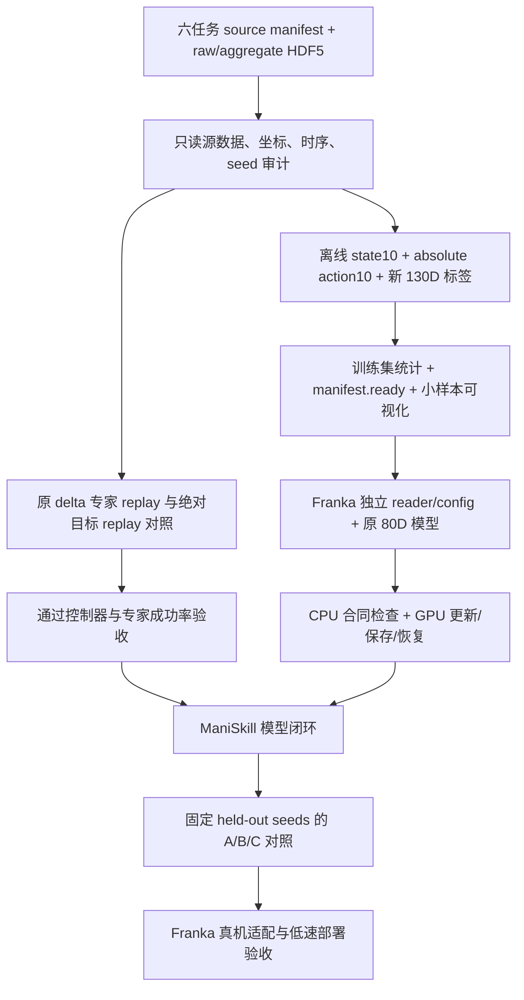

# Franka / ManiSkill 六任务绝对 EEF 训练与评估 Pipeline

日期：2026-10-16 UTC。状态：**只读核查与实施规划，尚未实现 Franka 训练或评估代码**。

用户约束：保留当前 Aloha 训练逻辑及运行进程；Franka 使用绝对 EEF；先写清 pipeline，不开始改代码。本轮仅新增本文及文档证据，不转换全量数据、不装环境、不占用新 GPU、不连接真机。

## 1. 可行性与边界

可以在现有 OpenWAM + Multi-Layer Relational Sidecar 上搭建单臂 Franka 的独立训练、ManiSkill 仿真评估链路。当前模型保留 80D 输出，单臂可以占用左臂 EEF10 槽位，其余维度通过 action/proprio mask 排除；无需为了单臂缩小或重置整个 action head。

当前 Aloha checkpoint 并不是已经验收的 Franka policy。可复用架构、Foundation 初始化及训练基础设施；Franka 数据适配、绝对动作控制器回放、完整模型更新/保存恢复及闭环表现仍需分别验收。真机还必须完成末端定义、相机、坐标和控制周期对齐，仿真成功不构成真机可用证明。

“与预训练对齐”在本方案中特指绝对位姿、EEF10/80D 槽位及 rotation6D 表示一致。不同机器人的末端原点、归一化范围、采样频率和专家动作来源并不因此自动相同。

## 2. 已找到的数据与原始 HDF5

用户指定入口：

```text
/remote-home/jinminghao/datasets/maniskill_eort_six_task_ea_rsig_v3_20260922
└── lerobot/train/ea_rsig_v3/<six task buckets>
```

六个 bucket 都是软链接，而非原始 HDF5 的存放位置。元数据表明它们是 LeRobot v2、20Hz、front/wrist 两路 256×256 视频，state8、增量 action7、EA targets125。

| 任务 | LeRobot 轨迹数 | LeRobot 帧数 | 原始来源根目录 | 完整训练 HDF5 选择 |
| --- | ---: | ---: | --- | --- |
| push_cube | 1000 | 60,916 | `maniskill_eort_color_distractors_v4_20260728` | raw replay HDF5 |
| pick_cube | 1000 | 78,520 | 同上 | raw replay HDF5 |
| stack_cube | 1000 | 108,140 | `maniskill_eort_task_suite_v5_20260730` | aggregate HDF5；原 raw 999 + 补采 1 |
| place_sphere | 1000 | 123,830 | 同上 | aggregate HDF5；原 raw 917 + 补采 83 |
| pick_cuboid | 1000 | 92,070 | 同上 | aggregate HDF5；原 raw 997 + 补采 3 |
| pick_sphere | 1000 | 78,533 | 同上 | aggregate HDF5；原 raw 998 + 补采 2 |
| 合计 | **6000** | **542,009** | 上述根目录均在 `/remote-home/jinminghao/datasets/` | 不用缺补采的原 raw 代替完整训练集合 |

原始文件例子：

```text
/remote-home/jinminghao/datasets/maniskill_eort_color_distractors_v4_20260728/push_cube/train/color_distractors/raw/PushCubeEORTColorDistractors-v1/motionplanning/push_cube_train_color_distractors_seed0_n1000.state_dict+rgb+depth+segmentation.pd_ee_delta_pose.physx_cpu.h5

/remote-home/jinminghao/datasets/maniskill_eort_task_suite_v5_20260730/place_sphere/train/color_distractors/aggregate/place_sphere_train_color_distractors_aggregated_n1000.state_dict+rgb+depth+segmentation.pd_ee_delta_pose.physx_cpu.h5
```

每个任务的 `train/color_distractors/derived_objectcentric_v4/manifest.jsonl` 已记录 `source_h5`、`source_trajectory`、`output`、任务指令、坐标及控制模式。**未来准备程序应逐条解析这个 manifest，不能凭文件名猜 source 或假定 LeRobot episode 编号就是原始 traj 编号。** 后四任务同时保留 `aggregate/manifest.json` 的补采映射，排查 train/val/test 的源 seed、episode 和轨迹重复。

实际 HDF5 已读到：

| 字段 | 形状 | 用途 |
| --- | --- | --- |
| `traj_*/actions` | T×7 | 原 Panda `pd_ee_delta_pose` 专家控制命令 |
| `traj_*/obs/extra/tcp_pose` | (T+1)×7 | **实际观测的世界坐标 TCP，xyz + quaternion wxyz** |
| `traj_*/obs/extra/robot_base_pose` | (T+1)×7 | 世界坐标机器人基座位姿 |
| `traj_*/obs/agent/qpos` | (T+1)×9 | 7 关节 + 2 指爪位置；构造当前夹爪开度 |
| `traj_*/obs/sensor_data/front_camera/rgb` | (T+1)×256×256×3 | 前视 uint8 RGB |
| `traj_*/obs/sensor_data/hand_camera/rgb` | 同上 | 腕部 uint8 RGB |
| `traj_*/env_states`、success、终止标记 | 按原记录 | 原状态回放、成功与时序核验 |

derived NPZ 另有 `tcp_pose_base_wxyz`、`robot_base_pose_wxyz`、物体/goal/base 坐标、接触和 bbox 信息。现有 LeRobot 的 `observation.state` 也已经是基坐标实际 TCP 的 xyz/Euler + pad + gripper。因而绝对 EEF **已经存在，不必从增量动作长期积分**；HDF5 用于保留完整 T+1 状态、重建新时间跨度标签及追溯原控制命令。

本轮证据：`docs/evidence/franka_maniskill_20261016/absolute_eef_source_audit.json`，记录六任务 manifest、完整 HDF5 路径、每任务首/中/末三轨迹的数值核对。该范围不是 6000 轨迹全量数值/视觉审计，也没有运行仿真。

实际完成的只读核对：六任务各 1000 条 manifest、各完整源 HDF5 1000 条轨迹；数值抽查 18 条轨迹、1614 个控制步。HDF5 转基坐标后的 TCP 与 derived 的位置最大绝对误差为 0、旋转最大误差约 6.83e-8 rad；按上述本地源码公式转换绝对目标并逆变换，归一化平移命令最大误差约 1.49e-8、旋转命令约 2.98e-8。这里只验证公式与已存数值，不是运行时 controller 实例对比。

同一抽样中，原命令的绝对目标与下一帧实际 TCP 的最大位置差 **2.50cm**、最大旋转差约 **0.062rad（3.55°）**。因此二者不能当同一标签使用；也不能由这一最大值推断全数据平均误差。

## 3. 绝对 EEF：区分当前实际位姿和专家目标

### 3.1 当前状态

所有位姿统一到 robot base：

```text
T_base_tcp[t] = inverse(T_world_base[t]) @ T_world_tcp[t]
state10[t]   = [p_base_tcp(3), columns_0_and_1(R_base_tcp)(6), gripper_open(1)]
```

输入 quaternion 明确 wxyz，送给使用 xyzw 的库前显式重排。rotation6D 使用现有 EEF helper 的两个旋转矩阵列拼接，不能换成按行 flatten。左右手系、米/弧度均绑定 manifest。

当前夹爪：`clip(mean(qpos[-2:]) / 0.04, 0, 1)`，0 关、1 开；这是当前 Panda 模型的两指合同，不可直接套用任意真机夹爪。

### 3.2 推荐训练目标：原专家命令对应的绝对目标

HDF5 中实际 `tcp_pose[t+1]` 是控制执行后的到达位置，**不是原控制器的目标位置**。直接用它做 action label 属于另一种 imitation target，会改变专家控制语义。

推荐先恢复原控制器期望到达的绝对位姿，再编码 EEF10。对当前本地 Panda 配置，`use_target=False`、root translation、root-aligned rotation：

```text
a_xyz      = clip(recorded_action[:3], -1, 1)
a_rot      = recorded_action[3:6] / max(1, norm(recorded_action[3:6]))
delta_p    = 0.1 * a_xyz
delta_R    = EulerXYZ_matrix(-0.1 * a_rot)
p_goal[t]  = p_actual_base[t] + delta_p
R_goal[t]  = delta_R @ R_actual_base[t]
g_goal[t]  = (clip(recorded_action[6], -1, 1) + 1) / 2
action10[t] = [p_goal, rot6d(R_goal), g_goal]
```

这里的 `EulerXYZ` 是本地控制器的 intrinsic XYZ 分解/构造约定；不是直接把后三维当 axis-angle。不能照搬旧 converter 中一个近似字段名称而跳过 controller 的裁剪/缩放逻辑。

训练 `action10[t]` 控制的是区间 t→t+1。以 t 为起点的 32 步标签为 `action10[t:t+32]`；当前状态是 `state10[t]`，未来视频含 `obs[t+32]`。不能又无依据地把命令数组错移一帧。这样保持“绝对 EEF 目标”表达，同时保留原专家的控制意图。

本地代码依据：`WAMs/ManiSkill/mani_skill/agents/controllers/pd_ee_pose.py` 的 `_clip_and_scale_action` / `compute_target_pose` / `set_action`，以及 `agents/robots/panda/panda.py`。本地 checkout HEAD 为 `b53792f638893816ae8644c2d30d1cc035ada6f3`；需同时记录实际文件 hash，因为 HEAD 不包含未提交差异。证据 JSON 保留两个 controller 源文件的 SHA256。

本地 Panda 源码中 `ee_link_name` 与 `tcp` 都指向 `panda_hand_tcp`，因此这份源码里的控制参考与观测 TCP 对应；部署到实际采集环境/真机时仍需验证该实例及 URDF 固定变换，不能只依据类名认定相同。

离线公式往返只能证明表达转换，不能证明 IK/物理回放成功。实施时必须以运行时 controller 实例的有效配置复核上述假设，并以同状态 teacher-forced target 比对及完整专家 replay 验收。若发现采集时版本不同，先解决版本差异，不能静默沿用公式。

### 3.3 与预训练末端定义对齐

现有 OpenWAM EEF 合同是“与手臂刚性连接、独立于指爪运动的末端坐标系”，不保证所有源数据都使用同一个 TCP/法兰原点。ManiSkill Panda 的 TCP、控制器 `ee_link` 和真机 flange/tool 必须核对固定变换。

若训练采用 TCP pose，manifest 明确 `eef_frame=panda_tcp`；如果为所选 Foundation Franka 参考系统一到 hand/flange，则对 state 和 action 同时施加同一个经过校验的固定 SE(3) 变换，评估时逆变换回控制器 TCP。禁止只改动作或只改观测。**不能复用 RoboTwin 的 local-x 0.12m 偏移。**

## 4. 总体流程



## 5. 离线准备，训练启动不重建数据

输出拟放 `outputs/franka_maniskill/absolute_eef_v1/`，原始 HDF5、LeRobot、旧 derived NPZ 只读。只保存轻量 numeric arrays / labels / stats / manifest，RGB 可直接按窗口读取源 HDF5；不先复制全部 HDF5 或重复编码视频。若实测 HDF5 chunk 布局不适合随机窗口，再单独评估视频缓存，不把它作为第一阶段必需工作。

准备阶段必须包括：

1. 枚举源 manifest，验证全部 6000 条映射、轨迹长度 T/T+1、动作/state/相机/指令对应，核对补采与数据拆分；保留 source path、traj、seed、size/mtime、controller 配置及版本。
2. 批量生成实际 state10 与绝对 command-target action10。记录二者与 next-achieved pose 的误差分布，不能混用不同动作语义。
3. 用真实轨迹重建新 130D 监督；见下一节。采用当前对象/目标语义和 8/16/32 时间锚，不直接转换旧 125D 数字布局。
4. 仅用训练集拟合归一化；初版建议 state 与 command-target 的 xyz 合并确定共同 min/max，夹爪固定 [0,1]、rot6d 保持 identity 范围；明确 artifact 的 state/action 使用同一坐标尺度。验证集/测试集不参与拟合。部署携带同一 stats 和散射映射，不能误用 Aloha stats。
5. 生成 versioned `manifest.ready.json` 和 labels/stats hashes。全量完整校验在离线阶段执行，训练启动 fast check 仅核对合同/缓存，首次访问按既有设计检查源变化；不每步重扫 6000 轨迹或全量哈希。
6. 验证首/中/末及 episode 末端窗口，RGB、bbox、TCP 和时间锚输出小预览后再全量使用。样本抽查和全量结构审计分开报告。

## 6. Sidecar 单臂与监督格式

### 6.1 输入、输出和相机

| 项目 | Franka 约定 |
| --- | --- |
| action/proprio 维度 | 仍为 80；EEF10 放 [0:10]，其余填 0 且 mask=false |
| arm presence | [1,0]；第二臂无假数据、无有效动作 loss |
| 观测 | 当前 front RGB、wrist RGB、当前 state10、任务指令 |
| 画布 | 沿用 384H×320W L 布局：front 在上、wrist 在左下，右下固定黑色缺失槽 |
| 第三视角 | bbox validity=0；不能复制 wrist 伪造第三路相机 |
| privileged 数据 | bbox、物体 pose、contact、goal 几何、未来轨迹仅进 auxiliary targets；不得作为 policy 当前输入 |

现有 Sidecar 从 80D proprio mask 识别单/双臂、屏蔽第二臂 token，具备复用基础；仍要增加针对 Franka 的实际 loss/梯度/推理合同测试。黑槽本身经 VAE/位置编码后不等于“没有特征”，现有注意力没有因此自动跳过该区域；初版沿用既有画布约定，不宣称已经实现 camera-key attention masking。是否需要新增相机显式 mask，留待受控验证后决定。

### 6.2 从源数据重新构造 130D，不给 125D 补零冒充转换

当前 Sidecar 接受 [B,1,130] dual-track targets，旧 ManiSkill 125D 是另一套单 object/goal 角色布局；二者索引与物理语义不同。

新标签只启用 track0（Franka 对应的 object/goal），track1 无效；四个 grounding roles 依次 Object0、Goal0、Object1、Goal1。未来双臂仍可使用同一 schema，不修改 Aloha 标签。

| 范围 | 含义 | Franka 构造 |
| --- | --- | --- |
| 0:2 | track valid | 有效目标的 track0，track1=0 |
| 2:8 | EE→object 关系 xyz | 与现有 loss/标签合同一致，使用当前 EEF 局部坐标 |
| 8:12 | contact + contact validity | 原始物理接触；缺失不能造为已知负例 |
| 12:16 | goal proximity + validity | 同现有距离映射；不可观测的虚拟 goal 不伪造可见 bbox |
| 16:52 | 3 anchors × 2 tracks × EE/object × direction3 | 从原 T+1 EEF、物体轨迹重新生成各角色当前局部坐标方向 |
| 52:64 | moving | 根据同一物理阈值重算；静止方向不回归 |
| 64:70 | future valid | 处理 episode 尾部、角色切换与 track validity |
| 70:118 | 四 roles × 三 views × bbox4 | 原始分割/已审计 derived bbox，像素除以真实源图大小 |
| 118:130 | grounding valid | 缺第二臂/第三视角置零，goal 再乘 goal-valid |

未来目标可以离线复用已验证原始几何，但旧 2/4/8 锚点及 derived 的 1/4/8 数据不能插值冒充 8/16/32。完整 HDF5 有轨迹可重算。目标移动、切换/遮挡、接触 valid 和各任务 goal 定义要逐项审查；`stack_cube` 的灰色支撑物与虚拟升高目标不可混为同一个可见实体。

默认 near 距离沿用当前 Sidecar 0.10m，goal proximity 沿用 0.5m 距离映射；这两项是显式可复现设定，不是已验证适合所有 Franka 任务的最优阈值。初期保持 A/B/C 一致，后续若调整需独立实验记录。

## 7. 训练合同与隔离边界

初版建议保持当前 OpenWAM 窗口结构：**32 actions、9 video frames，video anchors=0/4/8/.../32，plan anchors=8/16/32**。20Hz 下分别覆盖 1.6s，plan 为 0.4/0.8/1.6s。原 DiT4DiT 脚本是 8 actions、5 video frames 和 2/4/8 plan anchors，不能只切数据路径后沿用其旧标签。

32/9 保留现有基础路径，但不能称所有 Foundation 数据都与其物理时长相同。若后续采用 8/5 作为独立短窗口实验，视频 VAE 时间压缩、action sequence length 和 EA 锚点须联合确认，另写配置，不覆盖本方案。

Franka 新配置从 Foundation 新开独立 run，使用当前新 Sidecar 结构；预训练 state/action heads 尽量完整继承，不无依据重置。初次不拿训练一半的 Aloha checkpoint 当 Franka 已收敛初始化，不复用 Aloha optimizer/normalizer。后续 Aloha→Franka warmstart可做单独的权重迁移实验，以同预算 Foundation→Franka 作对照。

训练阶段沿用现有 warmup / action_only / joint 开关；先完成真实 joint 小步、保存与恢复验收，再启动长期训练。warmup 只能验证 Sidecar 梯度，不能证明 joint 的显存与稳定性。正式预算、batch、GPU 和总更新数在数据完成并实测后确定；当前 Aloha 的 bs32/acc2/global256 只是参考，**本方案不启动另一个十 epoch 作业**。

A/B/C 分别为 baseline、aux-only、读/精炼/写入完整 Sidecar；相同数据、绝对目标、归一化、batch/更新预算、ColorJitter、seed 与控制器协议。保留现有视频/action loss 与 BF16/ZeRO/checkpointing 设置；涉及公共主干的改变必须另行确认并回归。

## 8. 仿真执行与评估

### 8.1 绝对动作执行

本地 Panda 有 `pd_ee_pose`：use_delta=false、normalize_action=false，绝对 position + intrinsic XYZ Euler；gripper 是组合控制器的独立 [-1,1] 输入。优先评估这一路：

```text
model 80D -> gather EEF10 -> denormalize
         -> rot6d 正交化 / SO(3) 检查 -> base-frame p + EulerXYZ
         -> 若有固定 tool 变换，转换到 controller ee_link
         -> [p3, euler3, 2*gripper_open-1] -> env.step
```

需要核对原 recorded CPU sim 与 absolute controller 的 IK 求解器、stiffness/damping、ee_link、控制频率、仿真 backend 一致性。不能为了方便改 controller 或切 GPU physics 后仍称原协议复现。rotation6D 退化、非有限动作和超范围目标应明确报错/记录，不能吞掉并继续计成功率。

若 native absolute controller 未通过回放，备选在**执行适配层**将绝对目标相对实时 TCP 还原成原 delta 命令；训练标签与模型输出仍然是绝对 EEF。该路径须记录平移/旋转裁剪率、延迟和当前 TCP 使用方式。它也需要独立回放，不能用来掩盖目标定义错误。

### 8.2 验收顺序

| 阶段 | 验什么 | 过关证据 |
| --- | --- | --- |
| 原专家 replay | 环境/初始状态/资源与原数据匹配 | 从记录 env state 开始，原 delta 动作完成原生成功判据 |
| 同状态转换比对 | 绝对目标确实等于原 controller target | controller 实例输出的位置/姿态误差、动作往返误差 |
| 绝对专家 replay | 换表达/执行路径是否损伤专家表现 | 六任务多条原记录回放，成功率与轨迹偏差；不要求未经证实的 bitwise 相同 |
| Reader/模型短测 | 没有错位、泄漏、无效维度梯度 | CPU 合同、真实 Foundation joint 更新、权重保存/严格加载、完整状态恢复 |
| 开环检查 | held-out 上的目标、夹爪、EA 误差 | 原物理单位位置/角度误差，不仅 normalized loss |
| 模型闭环 smoke | 部署输入与 action chunk 路径完整 | 每任务少量独立 seed、原生 success、视频和动作裁剪日志 |
| 正式闭环 | A/B/C 在同协议下的行为与鲁棒性 | 固定 held-out seeds，逐任务成功数/实际分母及区间、耗时、失败分类 |

初版预测 32 步但只执行前 **8 步**再重规划，与原六任务常用 replan8 协议便于对照；同步推理、CFG1、初期关闭 compile/cache。episode reset 清空动作队列与模型临时状态；先验证一个串行环境再谈并发。

复用原六个 `*EORTColorDistractors-v1` 环境和对应 test seed manifests。旧脚本默认 50 episodes/task、max_steps200，作为**旧协议参照**记录；最终应同时记录 native horizon，确认没有额外 wrapper 提前截断。每任务实测成功数/实际完成数，异常退出 episode 不从分母静默剔除。原 test manifests 筛选过 expert-success seeds，必须在报告中说明；新增随机 held-out 评测单列，不和原固定集合混算。

不复用旧 DiT4DiT client/server 的 .pt checkpoint 加载和 163D state 打包。可复用环境注册、seed 读取、视频与结果聚合逻辑，但 OpenWAM 请求只包含当前 RGB/state/text，不携带旧 oracle current 或 EA future targets。

## 9. Franka 真机阶段

仿真和真机共享：绝对 base-frame EEF10、80D scatter/gather、相机槽位、训练 stats、模型 server 与 checkpoint合同。机器人执行端独立适配。

真机接入前需拿到实际硬件配置：Franka 型号/末端工具与 TCP、控制器接口（例如现有 ROS2/servo 链）、base/tool 变换、相机序列与标定、观测和控制频率、夹爪类型/开度范围。当前尚未核对这些内容，不写假定默认值冒充接通。

验收顺序为：记录观测回放推理 → 不执行的 shadow target 检查 → 低速空载小幅位姿追踪 → 简单实体任务 → held-out 任务评估。实际执行层根据机器人控制周期对目标插值/限速，工作空间、状态新鲜度、停机和队列过期处理必须验证；这些限制及触发次数记录到 rollout，不能用不透明裁剪隐藏 policy 输出错误。

仿真 oracle 仅训练监督；真机运行不要求提供精确 object/goal GT。但相机域差异、接触动力学、时延、TCP 标定误差和目标外观变化仍需实测，不能由“只使用 RGB+proprio”推导出 sim2real 保证。

## 10. 未来实施的最小文件范围（均未创建）

| 拟新增/涉及位置 | 职责 | 复用边界 |
| --- | --- | --- |
| `openwam/maniskill_eef_contract.py` | controller-target↔absolute EEF 的纯数值转换及帧合同 | 复用现有 EEF rotation helper，不复用 RoboTwin 工具偏移 |
| `scripts/prepare_maniskill_franka_absolute_eef.py` | 只写独立输出的离线数组、130D targets、stats、ready manifest | 复用通用 hash/统计/目标打包；不直接调用只接受 RoboTwin raw schema 的准备器 |
| `openwam/dataloader/maniskill_eort.py` | 源 HDF5 按窗口读取、mask、RGB 画布、增强 | 复用 BaseDataset、画布/增强/normalization helper；不伪装成 Aloha source |
| dataloader registry + 独立 Franka YAML | 注册与训练配置选择 | 仅新增注册项，不替换 Aloha 默认路径/类 |
| 独立 train/deploy/eval launchers | 训练、server、六任务评估 | 复用标准 trainer 与 OpenWAM engine，不把 Aloha 专用 GPU0–3 交接入口当通用 launcher |
| ManiSkill client / eval adapter | 当前状态、绝对动作、reset/seed/results | 复用原环境与评测协议，替换模型接口 |
| 小范围合同测试 | SE(3)/controller往返、时序、mask、标签与部署一致性 | Aloha 回归必须继续通过；不为文档编写新测试 |

预计无需改 block7/15/23 Sidecar 主体或公共 FM 定义。当前 130D loss/单臂 mask 已提供主要结构；若实施时发现确需修改公共模块，先说明具体原因并确认，默认保持 Aloha 数学与配置不变。代码开始前重读 `docs/思考与隐患.md`，重大改动写 MODIFICATION_LOG，实验结果回填本文；运行期间不安装/升级当前 Aloha 使用的环境。

## 11. 实施优先级与停止条件

1. **先验证绝对目标和专家 replay。** 这是决定方案是否可用的关键，不先花几天训练验证错误动作合同。
2. **再准备完整新数据与 reader。** 完成 frame/target/mask/统计合同及小预览，离线准备一次。
3. **再做模型工程验收。** 空闲卡上有界 joint 更新、保存重载/恢复，获得真实容量和吞吐；不停止或抢占当前 Aloha。
4. **最后长期训练与配对评估。** 预算/初始化/增强一致，区分工程可运行、学到目标和闭环成功。
5. **真机独立验收。** 等硬件接口资料与仿真结果充分后推进。

若 source 映射/补采不全、采集 controller 无法确认、绝对目标 replay 明显劣于原专家、或 true TCP/frame 尚未确定，先解决对应问题；不要靠全量训练弥补基础合同错误。

本轮完成的是数据可追溯性和方案核查。完整 6000 轨迹审计、绝对专家仿真 replay、Franka 模型训练、闭环与真机运行均未执行。
