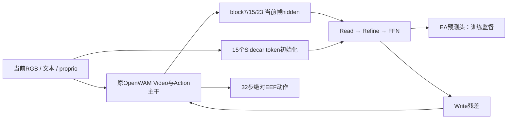

# OpenWAM Relational Sidecar：实现、训练实验与诊断完整总结

快照时间：**2026-11-02T15:13:07.306011+00:00**。项目根目录：`/remote-home/jinminghao/OpenWAM`。

本文保存当前已实现逻辑、训练配置、原始评估结果与诊断边界，供组会、论文设计和后续实验接续使用。动态进度以快照为准，不能把本文当实时监控。

原始数据快照：`outputs/analysis/sidecar_full_training_summary_20261102/snapshot.json`；历史高分三组渲染日志复核：同目录`historical_top3_render_audit.json`。本文编写只读代码和实验结果，没有修改训练、模型权重或在跑仿真。

## 1. 核心结论与口径

1. **已完成全50任务速测的最高记录是75.13%**：官方C2R起点→新Sidecar warmup2K→fresh optimizer低LR联合5epoch，权重`outputs/1031-warmup2k-fromc2r-5epoch/checkpoint_step_10740.safetensors`。Clean89.13%、Randomized61.13%；不是10epoch实验。
2. **额外完整联合10epoch方案中最高是74.83%**：原始warmup2K权重→fresh optimizer→完整PatchWAM联合10epoch，权重`outputs/1030-warmup2k-to-full10epoch/checkpoint_step_21480.safetensors`。Clean88.67%、Randomized61.00%。当前19组诊断使用这一权重，而非75.13%的C2R模型。
3. 两者只差9/3000次成功、0.30个百分点；起点、LR、训练量不同，不能证明前者显著更优或训练更高效。
4. 新增Sidecar为**4类15个512维latent token、3处Read/Refine/Write、约24.29M参数**。保留OpenWAM的Video/Action主干、主任务Flow Matching和80D动作/状态合同。
5. 训练数据离线18组720次生成已完成。Write/Grounding/角色嵌入等对训练轨迹拟合有小幅帮助；Relation/Plan平均拟合收益不明显。该结果不是闭环成功率。
6. 闭环19组尚未完成每条件10条。部分token reset在阶段配对样本上略好，但**不能据此宣布token无用、所有Sidecar有害或某组最终最优**。
7. 完全reset保留Write的可学习固定项，和关闭Sidecar不同。当前最值得验证的假设是“动态信息有时干扰决策，而固定写入/联合训练后的主干仍有作用”；这只是工作假设。

### 1.1 几个容易混淆的数字

- 全任务：**50个任务×Clean/Randomized=100个条件**，不是100个不同任务。
- 全任务速测：每条件30条，共3000条。官方发布参考为每条件100条。
- 完整100条扩展：每条件30+70，10000条；与一次性原生100条仍存在语言候选池差别。
- 本轮诊断：**10任务×2域×19组×10条=3800条最终有效样本**。目前仍在前5条阶段，不能把5条结果标成10条终态。
- 每epoch约2148次optimizer update；2K warmup约0.93epoch。旧4卡acc2文件名计microstep，`42960=21480 updates=10epoch`；新8卡acc1的`21480`直接是updates。XA也是21480更新，但其日志microstep为42960。

## 2. 在什么基础上做了什么改动

### 2.1 保留的OpenWAM基础

基础是预训练OpenWAM的Video/World backbone与Action backbone通过MoT联合注意力交互的架构。当前自包含Wan主干为30个block；不是把主干改成只有3层。保留：

- Video/Action双向联合注意力与`first_frame_causal`视频mask；当前帧clean prefix。
- 原视频和动作Flow Matching损失，默认权重各1。
- 文本、图像、当前proprio输入，80D统一动作/状态空间及inactive维mask；T5/VAE等原冻结模块继续冻结。
- 绝对EEF控制合同，输出32步动作；不把特权EA标签作为推理输入。

### 2.2 新增15个持续token

| 类型 | 数量 | 索引 | 功能/监督 |
|---|---:|---:|---:|
| Grounding | 4 | 0:4 | 双臂各2个，EEF/对象定位、presence/track有效性 |
| Relation | 4 | 4:8 | 双臂各2个，near/contact及goal proximity |
| Summary | 1 | 8:9 | 共享汇总latent，无独立语义监督头 |
| Plan | 6 | 9:15 | 3个horizon×双臂；每个读出EEF/Object方向与moving |
| 合计 | 15 | 0:15 | latent_dim512，8 heads |

同一组15个token持续经过三个接入点，不是新增45个独立token，也不是把15个token直接全部拼进原WAM序列。初始化为可学习role embedding加当前文本汇总与proprio投影。Sidecar输入都是当前可观测信息。

三个接入点是零起算block **7/15/23**，即第8/16/24个block之后。每处包括：

1. **Read**：将当前观测帧的Video hidden投影到512维，加位置/视角编码；以Sidecar token为query读取。
2. **Refine**：token self-attention、context注入和FFN，使15个token交换信息。
3. **EA heads**：从token读出Grounding/Relation/Plan，训练时用独立标签监督。
4. **Write**：以Action hidden为query、Sidecar token为K/V，通过带门控残差写回Action hidden。

EA head输出概率本身不作为动作条件；写回的是latent token。只把预测head输出置零，不会切断latent→Write路径。约24,290,323个Sidecar参数中，辅助heads约532,493个、占2.19%，三tap共享同一套heads。

主要代码：

- `openwam/model/modules/relational_sidecar.py`：token初始化、SidecarStage、ActionWriteAdapter、EAHeads。
- `openwam/model/architectures/dual_system/relational_sidecar.py`：三个tap、训练路由、loss聚合、全关闭父类路径。
- `openwam/model/architectures/dual_system/joint_self_attn.py`：保留的原MoT主干路径。

### 2.3 标签、动作和图像合同

训练实际使用`outputs/sidecar/aloha_4350/manifest.ready.json`指向的数据子集：**50任务、2500条Clean轨迹、约549775训练窗口**。目录名带4350，不代表本实验训练了4350条。原始来源：

`/remote-home/jinminghao/datasets/robotwin2_official_clean_ea_rsig_v3_4350_wrist020_schema5_20261015/raw/aloha`。

- 当前proprio取raw `endpose[t]`，动作监督取`t+1…t+32`；视频取0/4/…/32共9帧。
- raw双臂EEF20：每臂XYZ3＋column-Rot6D6＋gripper1；映射到模型80D的左0:10、右34:44。
- 四元数读取wxyz；使用checkpoint配套min-max统计，未用另一份checkpoint的stats替换。
- EA为独立130D训练标签，Plan horizon为8/16/32。辅助关系使用局部x方向偏移0.12m的TCP；不能把这个偏移直接加到控制action。
- 三视角原RGB为240×320；现有训练/评估拼接逻辑生成384×320画布：头256×320、两个腕部各128×160。训练和评估沿用同一几何约定。
- 未发现“训练proprio是IK目标而评估proprio是实际EEF”的混用。训练监督是专家实际未来EEF，评估把预测值当控制目标重新规划执行；重执行跟踪误差尚未因此被消除。

细节见`docs/ROBOTWIN_EEF_TRAIN_EVAL_ALIGNMENT_20261020.md`。不能把离线预测毫米误差直接当成执行后实际TCP跟踪误差。

### 2.4 辅助损失与梯度

原EA配置：Ground=.025、Relation=.01、Plan=.05，整体scale=.5。最终stage计算完整三类EA，另加deep=.1的浅层Ground和中层Relation：

\[
L=L_{video}+L_{action}+0.5\{.025G_2+.01R_2+.05P_2+.1(.025G_0+.01R_1)\}.
\]

默认完整联合训练时，EA梯度可沿Read/Refine回到主干；Action/Video损失也可训练Sidecar。不能把它描述为“辅助头独立训练、不影响主干”。

### 2.5 已实现的训练策略变体

|变体|实际改动|不能误称为|
|---|---|---|
|完整反向、WAM延迟更新2K|正常前向/反向和global clip；AdamW step前跳过WAM参数、动量、衰减，仅更新Sidecar|关闭全部WAM反向，或只设LR=0|
|从2K权重重新开始10epoch|加载权重，fresh optimizer/scheduler/step0；WAM和Sidecar从第一步联合更新|保留旧Adam历史的精确resume，或又冻结2K|
|WAM LR ramp100/300|解冻后短时间将实际WAM LR从原调度0.1倍恢复到1倍|额外冻结100/300步；所有后续实验都启用它|
|EA heads-only|仅detach辅助heads的tokens/features输入；EA只更新heads；主任务仍更新共享网络与Write|整个模型只训练0.53M heads，或推理关闭Sidecar|
|XA|训练态增强student第8层对齐EMA nominal teacher第20层；部署无teacher|推理多跑teacher或单独证明alignment有效|
|三阶段完整EA监督|三个tap均直接监督G/R/P，权重.2/.3/.5，保持各任务跨层系数预算|增加新token/新推理参数，或重复叠加旧deep loss|

对应实现还包括`openwam/train/utils/sidecar_warmup.py`、`sidecar_lr_screen.py`、`openwam/model/modules/cross_appearance.py`。这些是已经实现的可选能力，不能把某个开关存在等同于每个实验都实际启用了它。

### 2.6 PatchWAM增强

完整版本使用官方参考实现的appearance randomizer，接在既有多视角resize之后：每相机clip时序参数共享，三相机独立，缺失视角保持黑槽。p=.8，brightness/contrast/saturation=.4、hue=.1、gamma[.7,1.4]、exposure[-.5,.5]、noise=.03、blur p=.3，并启用AdaIN与FFT。旧ColorJitter关闭，避免双重增强。

没有新增图像旋转/平移或改动作/EA标签。Hue/AdaIN/FFT可能改变颜色指代语义，是尚未完全解决的风险。最佳10epoch模型使用完整增强；XA同时改成较温和增强并关闭Hue/AdaIN/FFT，因此XA对照不是单变量实验。

来源与实现：`docs/PATCHWAM_C2R_AUGMENTATION_20261027.md`、`openwam/dataloader/transforms/patchwam_appearance.py`。

## 3. RoboTwin历史完整覆盖结果

下面“完整”表示覆盖全50任务×双域，不表示都训练满10epoch，也不表示都是每条件100条。官方参考归档自OpenWAM Issue #46：Clean89.36%、Randomized48.72%、综合69.04%。相对官方差值仅作参考，样本数及语言池并不完全一致。

| ID | 方案 | Checkpoint | 新增训练epoch | 每条件条数 | Clean | Randomized | 综合 | 较官方pp | 状态 |
|---|---:|---:|---:|---:|---:|---:|---:|---:|---:|
| 官方 | 发布参考 | — | 既有训练 | 100 | 89.36% | 48.72% | 69.04% | +0.00 | 参考 |
| R01 | 原始Sidecar | 32000 | 约7.45 | 100 | 87.66% | 45.30% | 66.48% | -2.56 | 历史完整覆盖 |
| R02 | 早期warmup2K版本 | 24000 | 约5.59 | 30 | 87.13% | 49.27% | 68.20% | -0.84 | 历史完整覆盖 |
| R03 | 完整反向warmup2K | 24000 | 约5.59 | 30 | 85.80% | 46.47% | 66.13% | -2.91 | 历史完整覆盖 |
| R04 | 完整反向warmup2K | 32000 | 约7.45 | 30 | 89.00% | 53.20% | 71.10% | +2.06 | 历史完整覆盖 |
| R05 | 同一32k补满100条 | 32000 | 同一7.45权重 | 100 | 88.02% | 52.36% | 70.19% | +1.15 | 历史完整覆盖 |
| R06 | 同一连续训练 | 36000 | 约8.38 | 30 | 89.33% | 51.20% | 70.27% | +1.23 | 历史完整覆盖 |
| R07 | 同一连续训练终点 | 42960 | 10.00，内含warmup | 30 | 89.93% | 50.07% | 70.00% | +0.96 | 历史完整覆盖 |
| R08 | 40k分叉heads-only | 42960 | 10.00，末0.69改EA路由 | 30 | 90.07% | 50.67% | 70.37% | +1.33 | 历史完整覆盖 |
| R09 | PatchWAM+ramp100中期 | 20000 | 约4.66 | 30 | 84.20% | 55.33% | 69.77% | +0.73 | 历史完整覆盖 |
| R10 | warmup2K重载+完整10epoch | 21480 | 0.93+10=10.93 | 30 | 88.67% | 61.00% | 74.83% | +5.79 | 历史完整覆盖 |
| R11 | 官方C2R起点+warmup2K+低LR联合5epoch | 10740 | 0.93+5=5.93 | 30 | 89.13% | 61.13% | 75.13% | +6.09 | 最高历史完整速测 |
| R12 | 原warmup2K+XA联合10epoch | 21480 | 0.93+10=10.93 | 30 | 89.00% | 56.20% | 72.60% | +3.56 | 原始记录；1条件待复测 |

R04和R05是同一权重不同评估样本量，不是两个训练实验。R04→R07显示继续训练时Clean略升、Randomized回落；R08仅较R07多11/3000次成功，尚不支持heads-only带来稳定显著提升。R10比R07高4.83pp，但同时改变增强、优化器历史、训练暴露量，不能把全部提升归给单一改动。

### 3.1 最近完整10epoch训练及尚无SR的分支

| 分支 | 训练完成/预算 | 与R10的主要差异 | 当前闭环结果 |
|---|---:|---:|---:|
| 旧完整反向最终42960 | 总10epoch，含0.93 warmup | 旧ColorJitter，warmup在预算内，连续优化器 | 70.00%（3000条） |
| 40k→heads-only42960 | 总10epoch | 末0.69epoch限制EA回传，主任务仍联合 | 70.37%（3000条） |
| R10 / 1030最终21480 | 额外joint10，总约10.93 | fresh optimizer，完整PatchWAM，无重复冻结/ramp | 74.83%（3000条） |
| R12 / XA最终21480 | 额外joint10，总约10.93 | 增加XA，且增强变温和；batch16×8×acc2 | 72.60%原始记录；1条件渲染日志需复测 |
| 三阶段EA最终21480 | 日志确认10epoch结束，总约10.93 | 完整PatchWAM，无XA；三tap均G/R/P监督 | 尚无闭环SR；本地最终权重仍等待读取权限 |
| PatchWAM+ramp100最终42960 | 最终权重已存在，计划总10epoch | 从Foundation连续训练，2K warmup后ramp100 | 未找到该最终权重完整评测；20k/24k仅中期结果 |

三阶段本地目录为`outputs/1102-3stageall-10epoch`，配置和日志已回传，但快照时正式最终权重文件不存在，transfer状态为`waiting_for_checkpoint_permission`。不能把训练完成日志或metadata回传当作闭环已经有效。PatchWAM32k排队曾被取消，不能编造其SR。

### 3.2 部分评估、额外采样与空白项

下面不参加全任务排名；官方也只比较同一子集。

| 方案 | Checkpoint | 完成条件 | 有效条数 | 子集综合 | 官方同子集 | 状态 |
|---|---:|---:|---:|---:|---:|---:|
| Original Sidecar (A100 batch) | 42960 | 20 | 2000 | 76.90% | 78.10% | stopped |
| Original Sidecar (A100 inference +4090 sim batch) | 42960 | 21 | 2100 | 58.90% | 58.10% | stopped |
| Reproduced baseline (selected10 tasks) | 10740 | 20 | 2000 | 67.70% | 69.85% | subset_complete |
| Full-backward warmup2K | 20000 | 35 | 1050 | 68.38% | 72.49% | interrupted |
| PatchWAM C2R ramp100 | 24000 | 56 | 1680 | 70.06% | 66.98% | stopped_by_user |
| PatchWAM C2R ramp100 | 16000 | 4 | 120 | 36.67% | 24.75% | stopped |

另有R10补70在68条件处暂停：原30+70共6800条、5654成功，综合83.15%；其中全部50个Clean为88.78%，18个Randomized为67.50%。这是Clean占比更高的子集，不能把83.15%当全任务综合，更不能与75.13%直接排名。其余32条件补测按用户要求暂停，优先诊断。300-step WAM ramp的C短分支只训练到约1.86epoch，后续完整长训取消，不能列为一个已完成10epoch结果。

### 3.3 结果可信度与比较限制

- `warmup2k_full10epoch_21480_4090_all100_30ep_20261030`：本次只读复核100个已接受终态日志，明确渲染错误标记0个，缺失日志0个。

- `warmup2k_fromc2r_5epoch_10740_4090_all100_30ep_20261031`：本次只读复核100个已接受终态日志，明确渲染错误标记0个，缺失日志0个。

- `xa21480_4090_all100_30ep_20261101`：本次只读复核100个已接受终态日志，明确渲染错误标记1个，缺失日志0个。

R10与R11均未发现明确渲染错误，支持保留这两组的历史完整速测数值；这不等于所有像素/资产已逐一证明与官方相同。R12的`move_stapler_pad / demo_randomized`有OIDN错误日志，原记录13/30成功，应标记待复测。即便此条件修正为30/30，其综合上限也只有73.17%，仍低于R10的74.83%；但不同增强与采样仍不支持把差异单独归因XA。

其余旧历史表未在本次逐条件全面重扫渲染日志，保留为历史记录，不冒称它们已通过新增的完整渲染审计。当前诊断42个带错误日志的完成条件属于另一批运行，不直接改写R10/R11历史3000条成绩。

公平性限制：历史不同checkpoint未固定逐episode语言RNG；30条语言候选池与官方100不同；32k的100条是30+70扩展；heads-only有10条件L20、90条件4090。旧自训baseline10740只有选定10任务2000条、训练5epoch及不同统计，不能当作全50任务、同预算的架构消融baseline。

## 4. 最高成功率实验的精确配置

### 4.1 历史全任务速测最高：R11 / C2R起点10740

| 项目 | 配置 |
|---|---:|
| 最终权重 | outputs/1031-warmup2k-fromc2r-5epoch/checkpoint_step_10740.safetensors |
| SHA256 | b27cbb15180e35ccdc43748914f5f9f9adcd5d1c4eaa468eaf19f25a47a3a7fb |
| 初始化 | 官方OpenWAM-Alpha-Sim-RoboTwin-Clean2Random最终10740；新增Sidecar |
| 阶段1 | 完整反向，只更新Sidecar，2000 updates；Sidecar LR5e-5 |
| 阶段2 | 重新加载阶段1权重，fresh optimizer/scheduler，联合5epoch/10740 updates |
| 学习率 | Video/Action/base2.5e-5；Sidecar1.25e-5 |
| batch | 8卡×32×acc1=global256，BF16/ZeRO2/gradient checkpointing |
| 优化器 | AdamW betas(.9,.95)，weight_decay.01，clip1；cosine，5%LR warmup |
| 增强 | 完整PatchWAM p.8，Hue/AdaIN/FFT开，ColorJitter关 |
| 模型 | 完整15token/3tap Sidecar；EA scale.5；G/R/P=.025/.01/.05；deep.1 |
| 未启用 | XA、heads-only、EA梯度退火、第二次2K冻结、额外WAM LR ramp |
| 评估 | 50任务×2域×30，L20模型/4090仿真，eager+cache .99/max3、10去噪、chunk32、无视频 |
| 结果 | Clean1337/1500=89.13%；Randomized917/1500=61.13%；合计2254/3000=75.13% |
| 相对官方 | Clean−0.23pp；Randomized+12.41pp；综合+6.09pp |

官方起点已经包含其已有RoboTwin训练，5.93epoch只是本次新增预算，不能据此说总训练成本低于Foundation起点。配置中虽继承`sidecar_wam_ramp_updates=100`字段，但`sidecar_lr_screen=null`，没有安装LR ramp；不能把字段存在误写成实际执行。

### 4.2 最佳额外完整10epoch：R10 / 1030的21480

| 项目 | 配置 |
|---|---:|
| 最终权重 | outputs/1030-warmup2k-to-full10epoch/checkpoint_step_21480.safetensors |
| SHA256 | b141060b4ab33b0a2542effad452203b2ee5a5d287e5fd38ef092abe7326de7e |
| 起点 | Foundation-origin完整PatchWAM warmup2K权重；4000micro=2000updates |
| 起点SHA256 | 49b6c013eb910b9d0bc3071ec40a38915631d8a54dd6b73b1942d6968383835b |
| 训练 | 新optimizer/scheduler/step0，额外joint10epoch/21480updates；总暴露约10.93epoch |
| 学习率 | Video/Action/base1e-4，Sidecar5e-5；标准5%LR warmup+cosine至1% |
| batch/精度 | 8×32×acc1/global256，BF16、ZeRO2、gradient checkpointing |
| 优化器 | AdamW(.9,.95)，decay.01，global clip1 |
| 增强/损失 | 完整PatchWAM，与4.1同配方；Action/Video各1；EA及deep同4.1 |
| 明确关闭 | 重复backbone/isolation warmup、额外ramp、heads-only、EA退火、XA |
| 结果 | Clean1330/1500=88.67%；Randomized915/1500=61.00%；2245/3000=74.83% |
| 相对官方 | Clean−0.69pp；Randomized+12.28pp；综合+5.79pp |
| 诊断定位 | 当前训练离线和19组闭环诊断都固定这一权重，不混入R11/XA |

训练配置/日志均已留在两个输出目录。R10/R11的0.30pp差异没有经过同episode/指令的统计验证，宜描述为效果接近。当前不能写“R11确定优于R10”，也不能把完整100条尚未完成的R10写成每条件100。

### 4.3 训练日志概况（最后500个optimizer update均值）

下表按每个optimizer更新取最后一条micro记录。不同增强和目标导致loss绝对值不宜直接横向判优；训练loss低不代表闭环SR高。

| 实验 | 最终更新 | Total | Action | Video | EA | XA加权 |
|---|---:|---:|---:|---:|---:|---:|
| 1030-warmup2k-to-full10epoch | 21480 | 0.1599164 | 0.0002768 | 0.1121164 | 0.0475233 | — |
| 1031-warmup2k-fromc2r-5epoch | 10740 | 0.1653487 | 0.0003934 | 0.1160891 | 0.0488662 | — |
| 1101-XA-10epoch | 21480 | 0.1441045 | 0.0002417 | 0.0951821 | 0.0472927 | 0.0013881 |
| 1102-3stageall-10epoch | 21480 | 0.1599126 | 0.0002724 | 0.1119684 | 0.0476718 | — |

训练均完成到对应更新且末段指标有限；只看低loss不能宣称泛化已收敛。XA末500步实际XA/EA标量比例约2.94%，虽然目标为80%，但系数已到.5上限；不能把目标比例当实际实现。末点R10三处Write gate约−.00264、−.00252、+.00372，XA首处约−.01575；gate绝对值本身不是完整Write残差强度，必须结合投影/激活范数解释。

## 5. 评估基础设施已实现什么

### 5.1 RoboTwin标准性与吞吐

- 在独立路径保留官方RoboTwin快照与`robotwin-official`仿真Conda，日志记录commit `0aeea2d669c0`及原eval脚本hash；不覆盖原DiT4DiT流程。
- 保留专家筛seed、原生成功判据、任务动作预算、RT/OIDN渲染、EEF参考点与逐动作规划。优化没有把整个chunk改成一次不同的轨迹规划。
- 修复小样本统计分母，失败/初始化中断和未完整条件不计作模型失败或拼入完整SR。
- L20部署模型、4090运行仿真，通过SSH反向隧道连接；支持T5跨卡放置。XA单卡/split在2固定输入及一条真实轨迹的7个chunk/224个预测动作上逐元素一致，仅覆盖这些输入。
- 每份模型多端口，每端口独立Policy/action buffer；共享engine在锁内串行执行。诊断模式随每次请求在作用域内切换，避免跨会话污染。
- chunk传输把32步动作一次返回；已验证的chunk内部跳过冗余RGB拍摄/读回，保留本体状态、物理、规划、成功及原RNG相关流程；重规划边界仍获取完整RGB。
- 不保存视频。关闭录像不等于关闭模型所需的RGB。
- **尚未实现真正的多请求GPU批量推理。** 当前并发主要是多仿真重叠、共享模型串行服务及减少请求/渲染，不应宣传成已经完成跨仿真的batched inference。
- 正式历史对比多数使用eager＋DiT velocity cache(.99/max3)，10 denoise、chunk32、CFG1。cache是近似；不能说只影响速度、不影响动作。它在每次generate重置，不把一个simulator的历史当另一个的缓存。

### 5.2 真实渲染错误的处理

本轮发现部分exit0日志仍含OIDN错误；因此退出码与seed一致不足以说明图像可靠。当前将带明确渲染错误的完成条件隔离，最终同seed完整重测10；达到重试上限但明确属于基础设施的条件也交最终10条修复，不伪造前5结果。

原始日志/结果保留，渲染失败不当作策略失败。只保留必要的结果完整性/seed身份/错误日志检查，正常进程不中断；最终队列使用已有失败经验调整显存准入。不能为了占满显存而让错误帧进入成功率。

同seed配对只保证相同初始化清单与指令；干预改变动作后，闭环轨迹会分歧。固定输入数值等价也不自动证明所有轨迹或所有硬件完全等价。

## 6. 训练数据离线诊断：18组已完成

固定R10，10任务×2训练episode×2锚点=40窗口，每窗口未来32步，18组720次生成。原始权重/参数指纹不变，seed42、10 denoise、cache开启、compile关闭。比较专家实际未来EEF标签，结果不是执行后实际TCP误差、不是成功率、不是held-out泛化。双臂平均还可能被静止臂稀释，后续可按活动臂/阶段分析。

| 干预 | GT位置误差mm↓ | 较Full变化mm | 预测位置相对Full变化mm |
|---|---:|---:|---:|
| full | 4.8891 | +0.0000 | 0.0000 |
| write_off | 5.0347 | +0.1457 | 1.2306 |
| grounding_reset | 5.0422 | +0.1531 | 1.0674 |
| relation_reset | 4.8903 | +0.0012 | 0.6818 |
| summary_reset | 4.9010 | +0.0119 | 0.6501 |
| plan_reset | 4.8749 | -0.0142 | 0.7018 |
| all_tokens_reset | 5.0372 | +0.1481 | 1.2265 |
| visual_read_off | 4.9804 | +0.0913 | 1.0397 |
| refine_off | 4.9957 | +0.1066 | 0.9581 |
| sidecar_text_off | 4.9003 | +0.0112 | 0.7031 |
| sidecar_proprio_off | 5.0443 | +0.1552 | 1.0899 |
| write_tap7_off | 4.9393 | +0.0502 | 0.8176 |
| write_tap15_off | 4.8876 | -0.0015 | 0.7962 |
| write_tap23_off | 4.9262 | +0.0371 | 0.8372 |
| role_embedding_off | 5.1374 | +0.2483 | 1.1994 |
| ffn_off | 4.9829 | +0.0938 | 0.9321 |
| position_off | 4.8925 | +0.0034 | 0.7428 |
| stage_context_off | 4.9071 | +0.0180 | 0.8055 |

关闭Write、Grounding、role embedding后平均位置误差分别增加约2.98%、3.13%、5.08%。Write-Off和Grounding-Reset在10个任务均值上均略差；Relation reset几乎持平，Plan reset略好，不能说所有新增token都有收益。相邻窗口相关、每任务仅2条轨迹，不能给出强统计结论。

原先7组额外包含Grounding-head-off、Plan-head-off，各40窗口动作与Full逐元素相同。这验证预测头不直接反馈动作，不说明其训练loss没有作用。扩大18组中没有这两个head-only组；不能用继承的`head_only_controls_exact`布尔字段冒称本18组新做了head对照。全关闭Sidecar目前只加入闭环，未额外跑训练数据离线，不把Write-Off两fixture等价直接冒填成新的40窗口成绩。

原始数据：`outputs/robotwin_eval/sidecar21480_train_expanded_ablations_20261102/{plan,results,summary,complete}.json`；原7组在`sidecar21480_train_interventions_20261102`。

## 7. 当前19组闭环诊断：定义、进度与最新效果

### 7.1 固定任务与评估清单

| Task | 主要覆盖 |
|---|---:|
| adjust_bottle | 瓶子抓取/姿态 |
| beat_block_hammer | 工具接触操作 |
| handover_block | 双臂交接 |
| place_bread_skillet | 面包放置 |
| place_burger_fries | 多对象放置 |
| put_bottles_dustbin | 瓶子投放 |
| place_object_basket | 篮筐放置 |
| place_cans_plasticbox | 容器放置 |
| stack_blocks_three | 三层堆叠 |
| open_microwave | 铰接物体操作 |

先封存20份task/domain专家有效seed及unseen语言manifest，所有组共享同一份。原始Full/Write-Off/Relation-Reset已各测每条件10条。扩大到18组时曾自行缩为5条，用户指出后已更正为最终全部10条；当前前5保留，后5是同manifest逻辑index5:10，绝不简单把seed数值加5。原三组干净完整10条可复用，其余补齐；错误条件整10重测。该历史缩样不能隐去，所有阶段表明确标5条。

### 7.2 19组干预定义

| 组 | 定义 |
|---|---:|
| full | 完整Sidecar |
| write_off | 三个tap均跳过Write |
| grounding_reset | 每tap的read_refine后0:4置零 |
| relation_reset | 每tap后4:8置零 |
| summary_reset | 每tap后8:9置零 |
| plan_reset | 每tap后9:15置零 |
| all_tokens_reset | 每tap后15个token全部置零，Write保留 |
| visual_read_off | Read attention增量置零 |
| refine_off | token self-attention增量置零，FFN保留 |
| sidecar_text_off | Sidecar文本投影结果置零，主干文本保留 |
| sidecar_proprio_off | Sidecar proprio投影置零，主干proprio保留 |
| write_tap7_off | 仅跳过block7后的Write |
| write_tap15_off | 仅跳过block15后的Write |
| write_tap23_off | 仅跳过block23后的Write |
| role_embedding_off | 初始化减去role embedding，context保留 |
| ffn_off | Sidecar FFN增量置零 |
| position_off | Sidecar位置/视角投影置零 |
| stage_context_off | refine query中的context投影置零 |
| sidecar_off | 完整加载权重后sidecar_enabled=False，跳过Sidecar全部计算 |

token reset并非只关语义预测head，也不保证该语义在其他token/主干中被完全抹除；token间self-attention会交换信息。所有组均为同一已联合训练权重的推理干预，不是重新训练baseline。

### 7.3 快照进度

- 前5阶段记录完成：**1740/1900条**；其中未被明确渲染错误日志标记的完成记录为**1530条**。
- 带错误日志的完成条件：42个；另有2个终态基础设施失败需要完整10条修复。错误日志不一定意味着每帧都坏，但确认前不纳入可靠SR。
- 原两队列在跑/切换共19路；完整后5/修复队列已接续配置，快照时**尚未开始**。
- 最终目标仍为380个10条条件/3800有效rollout；不能把当前前5阶段进度当完整任务已结束。
- 主要目录：`sidecar21480_expanded_ablations_20261102`、`sidecar21480_all_off_20261102`、`sidecar21480_19arms_complete10_20261102`，均在`outputs/robotwin_eval/`下。

### 7.4 各组与其相同条件Full比较

只纳入完成且未标记渲染异常的条件；若配对Full被隔离，该条件也不用于比较。各行覆盖的任务子集和Clean/Randomized比例不同，**只能横向看该行与Full，不能按本列成功率跨行排名**。

| 组 | 配对条数 | 同批Full成功率 | 本组成功率 | 差值pp |
|---|---:|---:|---:|---:|
| full | 95 | 76.84% | 76.84% | +0.00 |
| write_off | 90 | 77.78% | 81.11% | +3.33 |
| grounding_reset | 75 | 82.67% | 86.67% | +4.00 |
| relation_reset | 90 | 78.89% | 86.67% | +7.78 |
| summary_reset | 85 | 81.18% | 87.06% | +5.88 |
| plan_reset | 85 | 82.35% | 88.24% | +5.88 |
| all_tokens_reset | 70 | 78.57% | 85.71% | +7.14 |
| visual_read_off | 80 | 81.25% | 82.50% | +1.25 |
| refine_off | 75 | 80.00% | 88.00% | +8.00 |
| sidecar_text_off | 70 | 82.86% | 88.57% | +5.71 |
| sidecar_proprio_off | 90 | 81.11% | 84.44% | +3.33 |
| write_tap7_off | 75 | 81.33% | 85.33% | +4.00 |
| write_tap15_off | 75 | 85.33% | 89.33% | +4.00 |
| write_tap23_off | 65 | 86.15% | 89.23% | +3.08 |
| role_embedding_off | 65 | 81.54% | 78.46% | -3.08 |
| ffn_off | 70 | 82.86% | 85.71% | +2.86 |
| position_off | 65 | 80.00% | 81.54% | +1.54 |
| stage_context_off | 70 | 78.57% | 80.00% | +1.43 |
| sidecar_off | 75 | 84.00% | 82.67% | -1.33 |

### 7.5 六个候选完全相同条件上的公平比较

| 方案 | 成功/共同条数 | 成功率 |
|---|---:|---:|
| full | 46/55 | 83.64% |
| write_off | 46/55 | 83.64% |
| relation_reset | 49/55 | 89.09% |
| plan_reset | 49/55 | 89.09% |
| all_tokens_reset | 50/55 | 90.91% |
| sidecar_off | 46/55 | 83.64% |

共同条件为：adjust_bottle/demo_clean；beat_block_hammer/demo_randomized；open_microwave/demo_clean；place_bread_skillet/demo_clean；place_bread_skillet/demo_randomized；place_burger_fries/demo_clean；place_cans_plasticbox/demo_clean；place_object_basket/demo_clean；put_bottles_dustbin/demo_clean；put_bottles_dustbin/demo_randomized；stack_blocks_three/demo_clean。

此共同子集每组55条。All-Tokens-Reset目前比Full多4次成功，Relation/Plan reset分别多3/3次，完整关闭的差值为0次；这些净差很小，没有全19组/全10条的最终赢家。Refine-Off等在自己的匹配子集上也可能高于Full，不能将它与上述共同子集直接排序。

### 7.6 原三组10条试验的历史结果及影响集中性

| 域 | Full | Write-Off | Relation-Reset |
|---|---:|---:|---:|
| Clean | 92/100=92% | 91/100=91% | 93/100=93% |
| Randomized | 62/100=62% | 68/100=68% | 70/100=70% |
| 合计 | 154/200=77% | 159/200=79.5% | 163/200=81.5% |

这是最初600条的原始记录，现已发现其中3个条件有渲染错误日志：adjust_bottle/Randomized/Relation-Reset、handover_block/Randomized/Full、place_burger_fries/Randomized/Write-Off。上表不再当作全部干净的最终因果证据；当前7.4/7.5已排除对应条件，最后将同seed完整重测。

原始Randomized差异主要集中于put_bottles_dustbin与place_object_basket：两者贡献Write-Off净增6次中的5次、Relation-Reset净增8次中的6次，并非10任务全部变好。这个集中性用于筛选复测重点，仍应以最终干净结果重新计算。逐任务旧表见`docs/ROBOTWIN_21480_INTERVENTIONS_LIVE_20261102.md`。本总结同时附机器可读的380行任务/域/模式状态矩阵，不把待测或待复测填成0%。

## 8. All-Tokens-Reset为何不等于关闭Sidecar

当前置零位置是`read_refine`返回的latent Z，发生在Write之前；不是直接把投影后的K或V置零。

\[
X=LN(Z),\quad K=W_KX+b_K,\quad V=W_VX+b_V,
\]
\[
A'=A+\beta P\{W_O[softmax(QK^T)V]+b_O\}.
\]

即使Z=0，LayerNorm affine bias及MHA投影bias仍可能非零。相同的零token使有效K/V各行相同，注意力对这些相同V的加权和近似固定；所以All-Reset更接近逐层固定写入项：

\[
A'\approx A+c_{layer}.
\]

后续主干仍是非线性的，因此“固定hidden残差”不等于“最终动作加固定毫米偏移”。主干图像、文本、proprio也始终保留，模型没有失去全部观测。

- **All-Tokens-Reset**：抹掉动态latent内容，但保留固定Write效应。
- **Write-Off**：严格跳过整个Action Write，hidden原样返回；仍计算Sidecar其他部分。
- **Sidecar-Off**：全部Sidecar计算跳过，走父类主干路径。

两个固定输入下Write-Off与Sidecar-Off的32步动作逐元素一致；这是有限输入证据。实际闭环仍出现少数不同结局，原因尚未通过更多同输入镜像动作对照定位，不能直接断言两者在所有状态严格等价，也不能把小净差当可靠因果。

### 8.1 对reset阶段优势的工作假设

1. 联合训练后主干本身已具备操作能力，可能已吸收辅助监督的训练作用。
2. 部分场景中的动态Ground/Relation/Plan表示不可靠，经Write放大后干扰决策；清空动态部分可能更稳。
3. 保留的固定Write项可能维持了主干适应的激活分布，而完全关闭会改变这一分布。
4. 当前少量净成功差也可能是小样本波动；token置零还有分布外扰动，不能自动解释为纯语义消融。

以上均不是已证明机制。离线训练误差略增而部分闭环略升，提示拟合与闭环鲁棒性不等价，但没有单独证明过拟合或某类token有害。

## 9. ManiSkill迁移评估已实现及当前结果

### 9.1 实现范围

将同一Sidecar体系接入归档原生Franka八任务：保持80D模型结构，部署副本只激活单臂0:10、选原stats前10维，缺失臂保持mask，front+hand画布第三视角为黑。绝对base-frame TCP输出经原桥接转pd_ee_pose。没有改原训练数据或把特权object pose输入策略。

完整标准为8任务×100 Clean＋100 HardRandom=1600；Clean是held-out test优先再补val，不能写纯test；HardRandom为test D25/M75，原600控制步。各episode从归档原生env ID/domain/hard_index/reset kwargs/初始状态恢复后闭环执行，不是回放专家算policy SR。

当前20872为ManiSkill额外1epoch最终microstep（10436 optimizer updates），初始化来自多仿真midtrain56892；不是Robotwin的21480权重直接测试。GPU3完整模型、GPU0四路sim，FFN+cache、10去噪、预测32/执行8后重规划，不存视频。24场景专家控制桥接和固定输入FFN验收通过，编译与匹配cache参考maxabs0，温推理约.418秒/chunk。cache本身仍近似。

已按用户AGENTS.md第12条简化日常启动：相同数据/环境/结构/代码复用清单、专家回放与FFN数值记录及编译缓存，新权重只正常加载+一次动作smoke；不再每次全套验收，不再默认33GiB等待。首次或关键条件改变才重验，保留seed/覆盖/渲染错误等直接影响SR的检查。当前在跑的评估不重启。

| 任务/域 | 完成条数 | 成功数 | 阶段成功率 |
|---|---:|---:|---:|
| lift_peg_upright/Clean | 100 | 72 | 72.00% |
| lift_peg_upright/HardRandom | 100 | 72 | 72.00% |
| pick_cube/Clean | 76 | 70 | 92.11% |
| pick_cube/HardRandom | 1 | 1 | 100.00% |

快照累计277/1600条、215成功（77.62%），仅覆盖以上条件；不是八任务宏平均，更不能与RoboTwin百分比混在一起。完整结果尚未形成。入口`scripts/eval_maniskill_archive.sh`，手册`docs/MANISKILL_ARCHIVE_EVAL_PORTABLE_GUIDE_20261102.md`，实时目录`outputs/maniskill_eval/final20872_l20_gpu3_novideo_20261102T130608Z/run`，最终`summary.json`仅全1600覆盖后写出。

## 10. 现在能说明什么、还不能说明什么

| 证据 | 可以说明 | 暂不能说明 |
|---|---:|---:|
| R10/R11完整3000条 | 当前配方有不错的历史全任务速测表现，Randomized高于官方参考 | 增益全部由15token或动态Write导致；0.3pp显著优势 |
| 18组训练离线 | 若干分支帮助训练轨迹动作拟合 | held-out泛化或真实闭环一定提高 |
| 19组阶段配对 | 部分reset在特定匹配样本未下降/略升 | 全部token有害、全reset确定最优 |
| Full关闭Write/Sidecar | 检验已联合训练模型的推理路径依赖 | 等价未训练Sidecar的原版baseline |
| XA训练loss与SR | 当前组合未超过R10，且存在增强/batch混杂 | alignment单因素必然有害；更低loss等于更好SR |
| 三阶段训练完成 | 代码与生产训练已完成到终点 | 模型已在本机完整可读或已有闭环收益 |
| ManiSkill部分成功 | 新平台控制/模型接入和部分任务闭环已跑通 | 八任务平均或跨平台泛化结论已完成 |

### 10.1 论文应如何表述

可以写实现、完整配方成绩和诚实的推理干预诊断。若最终reset仍优于Full，就需要限制“动态关系信息在推理中带来收益”的主张；不能靠一个合理故事把它包装成已证明的正面机制。

可用的暂定表述：

> 探索性配对实验中，清空Sidecar latent而保留写入路径后，部分任务成功率未下降或略有提高。这限制了将策略性能直接归因于动态关系条件的解释，并提示需区分辅助监督、联合训练主干与固定写入项的贡献。

只有等预算、同起点、同增强的训练baseline显示优势，才有证据进一步主张“关系监督改善表征学习”；当前不能直接把这句当最终贡献结论。

## 11. 后续行动：按优先级推进，避免同时叠新因素

### 优先级1：完成当前已授权评估

- 让19组统一每task/domain10条全部完成；渲染异常/缺失前5的条件整10重测，其他前5+互斥后5合并，最终380条件/3800有效条。
- 报告同seed/同语言的任务级成功率、净成功变化及配对置信范围；不要只看平均最高的几个百分点。
- 完成ManiSkill1600，并分8任务、Clean、D/M统计；不混入旧六任务baseline协议。
- 保留日志、清单、完整与阶段结果的区别；继续关闭录像，已验收环境不重复全套。

### 优先级2：用现有结果定位Write，而非马上再开多条长训

若最终All-Reset/Relation-Reset仍有稳定优势，先检查三个tap的Write残差均值、波动和范数，区分固定项与动态项，按成功/失败及操作阶段拆分。用少量固定输入可完成部分分析，不必重跑整套环境。

最有区分力的后续推理验证是：保留reset对应的固定Write项，仅逐步加入Full动态增量（例如两个中间强度）；观察同一清单下是否存在稳定的强度—性能关系。这比再新增很多含义重叠的token reset组更聚焦。该项是建议，本文没有擅自启动。

### 优先级3：补最小训练因果对照

在相同数据、增强、归一化、优化器与主干更新预算下比较：原WAM baseline、辅助监督但不在线Write、完整Sidecar。明确是否匹配主干更新数或总数据暴露/算力预算，并披露额外2K的成本。不能把推理Write-Off代替从头训练的baseline。

如需单独分析XA，使用同一增强、batch/acc、起点与预算的lambda=0对照。暂不同时更改XA、增强、tap、loss权重和Write强度。颜色任务的Hue/AdaIN/FFT语义风险也宜单变量验证。

### 优先级4：补足高分模型的标准覆盖

诊断完成后，按原计划优先恢复R10剩余32个条件的70条补测，保留已完成68条件，不重复旧30条；再决定是否对R11做统一manifest更大样本比较。当前75.13和74.83都是30条速测结果，不应取代全100条证据。

三阶段权重先解决合法读取/回传权限，再用同协议评估，不以训练loss预判胜负。上述新训练/新实验建议需结合当前结果另行确定，本文件仅保存分析，没有改变在跑计划。

## 12. 结果与源码索引

- 实现：Sidecar：[openwam/model/modules/relational_sidecar.py](../openwam/model/modules/relational_sidecar.py)

- 实现：架构/损失：[openwam/model/architectures/dual_system/relational_sidecar.py](../openwam/model/architectures/dual_system/relational_sidecar.py)

- 完整配方最高R11：[docs/ROBOTWIN_C2R_WARMUP2K_5EPOCH10740_FINAL_20261031.md](../docs/ROBOTWIN_C2R_WARMUP2K_5EPOCH10740_FINAL_20261031.md)

- R10评估配置：[docs/ROBOTWIN_WARMUP2K_FULL10EPOCH21480_EVAL_20261030.md](../docs/ROBOTWIN_WARMUP2K_FULL10EPOCH21480_EVAL_20261030.md)

- R10部分补100：[docs/ROBOTWIN_FULL21480_SUPPLEMENT70_STOPPED68_20261101.md](../docs/ROBOTWIN_FULL21480_SUPPLEMENT70_STOPPED68_20261101.md)

- 32k完整100：[docs/ROBOTWIN_FULLBACKWARD32K_COMPLETE100_FINAL_RESULTS_20261028.md](../docs/ROBOTWIN_FULLBACKWARD32K_COMPLETE100_FINAL_RESULTS_20261028.md)

- XA完整速测原记录：[docs/ROBOTWIN_XA21480_FINAL_20261102.md](../docs/ROBOTWIN_XA21480_FINAL_20261102.md)

- 三阶段配置/状态：[docs/SIDECAR_ALLSTAGE_WARMUP2K_10EPOCH_20261031.md](../docs/SIDECAR_ALLSTAGE_WARMUP2K_10EPOCH_20261031.md)

- 19组最终10条计划：[docs/ROBOTWIN_21480_19ARMS_COMPLETE10_20261102.md](../docs/ROBOTWIN_21480_19ARMS_COMPLETE10_20261102.md)

- 18组定义及离线结果：[docs/ROBOTWIN_21480_EXPANDED_ABLATIONS_20261102.md](../docs/ROBOTWIN_21480_EXPANDED_ABLATIONS_20261102.md)

- All-Off定义：[docs/ROBOTWIN_21480_SIDECAR_ALL_OFF_20261102.md](../docs/ROBOTWIN_21480_SIDECAR_ALL_OFF_20261102.md)

- ManiSkill当前运行：[docs/MANISKILL_FINAL20872_L20_LIVE_20261102.md](../docs/MANISKILL_FINAL20872_L20_LIVE_20261102.md)

- 历史汇总底表：[docs/ROBOTWIN_ALL_EVAL_SUMMARY_FROM32K_20261031.json](../docs/ROBOTWIN_ALL_EVAL_SUMMARY_FROM32K_20261031.json)

- 本报告完整机器快照：[outputs/analysis/sidecar_full_training_summary_20261102/snapshot.json](../outputs/analysis/sidecar_full_training_summary_20261102/snapshot.json)

- 历史高分日志复核：[outputs/analysis/sidecar_full_training_summary_20261102/historical_top3_render_audit.json](../outputs/analysis/sidecar_full_training_summary_20261102/historical_top3_render_audit.json)

- 诊断逐条件矩阵：[outputs/analysis/sidecar_full_training_summary_20261102/diagnostic_task_condition_matrix.csv](../outputs/analysis/sidecar_full_training_summary_20261102/diagnostic_task_condition_matrix.csv)

官方参考：[OpenWAM Issue #46](https://github.com/OpenWAM-Official/OpenWAM/issues/46)。本报告使用本项目已归档的发布表（89.36/48.72/69.04），没有把它描述成重新抓取的最新网站数据。原完整评估结果及逐条件原生输出路径保留在snapshot的recent_native_results及历史底表source字段。
