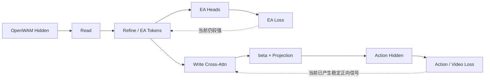
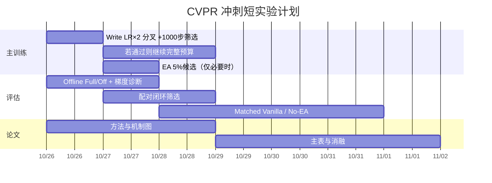

# OpenWAM + Multi-Layer Relational Sidecar：CVPR 截稿前的低风险增益实验方案

## 执行摘要

结合你们已经完成的 **WAM Delayed-Update Warmup 2K + 10 Epoch** 训练、最新真实写回诊断和此前梯度分析，我的总体判断已经和早期不同：

> **现在最重要的问题已经不是“Sidecar 能不能进入 WAM”，而是“怎样让已经有效的 Sidecar→Action 通路学得更快、更好，同时不要破坏当前最有价值的 Randomized 泛化”。**

你们现在已经跨过了一个关键门槛。根据你本轮提供的数据，最新 Warmup 模型在 Block 7/15/23 上的实际写回已经达到 **0.6118% / 0.6530% / 0.8988%**，约 87%–91% 的 Action Hidden 元素发生了真实变化；Full 相比 Write-Off 的 Action FM Loss 在 Clean/Randomized 上分别降低 **5.35% / 5.96%**，32 组配对中 29 组支持 Full。相较旧 Isolation Warmup 的 \(10^{-7}\sim10^{-6}\) 实际写入，新方案已经不是“写不进去”的模型了。你进一步确认完整 10-Epoch Warmup 方案平均比 Baseline 高约 **2 个百分点**，这意味着当前 recipe 应被视为**可工作的主干方案**，不能再用大幅架构重构去冒险。

这也与 OpenWAM 本身的研究结论相符：OpenWAM 的官方研究强调，WAM 的关键不只是世界表征本身，而是要有**专门的动作容量、明确的 world-to-action information flow 和同步的 world-action 学习**；其预训练收益尤其体现在 OOD 泛化上。citeturn0academia2turn3search2 最近的 Magic-W0、OA-WAM 等工作也都朝着“结构化世界表示必须真正成为 action-addressable/action-relevant 信息”的方向发展。citeturn3academia21turn0academia3

因此，我**不建议下一轮优先做更深的 Sidecar、显式 Relation Bridge、重新初始化 Gate、强行增大 β 或新增辅助 Head**。当前实现已经足够复杂：三个 Stage、Read/Refine/Write、约 24.29M Sidecar 参数、15 个关系 Token，以及 Grounding/Relation/Plan 监督。内部实施审查也已经指出，目前最缺的是“关系监督带来了可归因的控制收益”，不是更多模型容量。fileciteturn0file0

### 我建议立即启动的下一轮实验

如果现在只能占用一组 4×A100 开一条训练线，我的首选不是之前提议的 `EA shared gradient 100% → 1%`，而是：

\[
\boxed{
\textbf{保持 EA 监督完全不变，Stage 2 开始只把 Write Adapter 的学习率提高到 2×}
}
\]

具体来说：

- 仍从**当前成功 run 的同一个 2K optimizer-update 完整状态**分叉；
- WAM LR 不变；
- Read/Refine/EA Heads LR 不变；
- EA Loss 不变；
- β、Write Cross-Attention、Write Output Projection 独立 param group，**LR ×2**；
- 先连续训练 **1000 optimizer updates**，不中断 GPU；
- 在 +250、+500、+1000 保存 checkpoint，由空闲 GPU 异步做诊断；
- 1000 步没有明显负面信号，就直接续到完整 10 Epoch。

原因很简单：**你们目前最可靠的正面证据已经证明 Write 对 Action 有帮助，而不是证明 EA 在伤害 Action。** 旧梯度的 Action–EA cosine 是 +0.031，接近正交而不是明显负冲突。因此，我更愿意先提高“如何使用关系信息”的学习速度，而不是削弱“关系信息本身”的训练。PCGrad 等方法本来主要针对负梯度冲突；你们当前更像是**梯度幅值失衡而非方向冲突**。citeturn5academia12turn4academia0

如果第一条候选不够好，第二优先才是：

\[
\boxed{
\rho_{\rm EA}:1.0\rightarrow0.05\quad\text{over 500 updates}
}
\]

而不是直接降到 1%。你们目前最有价值的收益集中在 Randomized，因此我不希望在尚未证明持续 EA 监督有害的情况下，一次性削弱 100 倍。

下面给出完整方案。

## 当前实现与真正的瓶颈

### 现阶段已经解决的问题

你们早期最大的技术问题是 Sidecar 虽然能预测关系，但几乎没有真正改变 Action Hidden。旧 Isolation Warmup 24K 的实际写入比只有：

| Stage | 旧实际写入比 |
|---|---:|
| Block 7 | \(4.68\times10^{-7}\) |
| Block 15 | \(5.56\times10^{-6}\) |
| Block 23 | \(3.29\times10^{-6}\) |

而且旧模型 Full/Off Action FM、XYZ Error 和闭环都没有稳定优势。旧实验还观察到 Clean Refine 上 EA/Action 梯度范数比中位数约 \(3.6\times10^4\)–\(5.7\times10^4\)，Action–EA cosine +0.031，Action–Video −0.011。内部审查因此将问题概括为：共享 Sidecar 主要被辅助目标塑造，而 Action 对其影响非常弱。fileciteturn0file0

最新 Delayed-Update Warmup 已经改变了这一点。

| 指标 | Block 7 | Block 15 | Block 23 |
|---|---:|---:|---:|
| β | −0.00818 | −0.00989 | −0.00989 |
| 实际 residual / hidden | **0.6118%** | **0.6530%** | **0.8988%** |
| Hidden 实际改变元素 | \multicolumn{3}{c}{约 87%–91%} |

与旧模型相比，按实际写入比例粗略计算，新模型约高 **13,000× / 1,170× / 2,730×**。当然，这不是严格单变量比较，因为训练 recipe 和预算不同。

更关键的是：

| Full vs Write-Off | Clean | Randomized |
|---|---:|---:|
| Action FM Loss | **−5.35%** | **−5.96%** |
| Full 更好的 batch | 15/16 | 14/16 |
| XYZ Error | 11.345 → **11.166 mm** | 15.887 → **15.650 mm** |

因此现在不能再说“Sidecar 没有作用到 WAM”。你们已经观察到：

\[
\boxed{
\text{Relational Sidecar}
\rightarrow
\text{non-trivial Action Hidden perturbation}
\rightarrow
\text{lower paired Action loss}
}
\]

这条链路目前已经有直接诊断支持。

### 现在剩下的核心瓶颈

当前更准确的瓶颈是：

\[
\boxed{
\text{Sidecar 已经能帮助 Action}
\quad\text{但仍不知道如何最大化这一收益而不破坏 OOD 泛化}
}
\]

这里有四个具体问题。

**首先，Write 分支目前是有用的，但它可能仍然“学得不够快”。** EA Loss 不直接训练 Write 的 β 和最终输出投影；它们主要依赖 Action/Video 主任务梯度。内部实现审查明确指出了这一点。fileciteturn0file0 所以，与其立刻减少 EA，我认为最自然的第一步是**让 Write-specific 参数更快适配**。

**其次，EA 与主任务仍存在梯度量级不平衡，但没有证据表明存在强方向冲突。** GradNorm 等多任务学习方法的核心观察就是共享网络中不同任务梯度幅值会显著影响训练动态；PCGrad 则针对相互冲突的梯度方向。citeturn4academia0turn5search1 你们的 +0.031 并不是“EA 在朝反方向破坏 Action”，所以直接把 EA 从 100% 减到 1% 是一个比现有证据更强的假设。

**第三，WAM 从第 2K 更新恢复时存在明确的优化边界冲击。** 内部日志中，Warmup 前梯度 norm 最大约 0.929，而 WAM 恢复更新后的窗口最大达到 12.558，随后到约 3.3K 又恢复到正常水平；同时 WAM 在第 2K 解冻时 scheduler 已经推进到接近峰值 LR。fileciteturn0file0 这说明短 WAM LR Ramp 是一个有数据依据、但主要解决稳定性而非 Sidecar 利用率的候选。

**第四，当前 Auxiliary Heads 的显式预测并没有直接作为数值输入写回 Action。** 实际 Write 使用的是 relation latent tokens，而不是 Contact/Goal/Future Direction 的解码数值。内部代码审查已经确认这一点。fileciteturn0file0 所以现阶段论文必须避免写成“预测关系后直接将关系变量喂给动作模型”；更准确的表述是“privileged relational supervision shapes latent representations that are progressively written into ActionDiT”。

这也是为什么我现在不建议马上加 Explicit Relation Bridge：当前 latent write 已经开始有效，先榨干这条成熟路径的潜力更符合 Deadline 策略。



OpenWAM 官方研究本身就强调 explicit world-to-action visibility 是形成 world-action synergy 的重要条件，因此继续优化已有的“关系表征 → Action”接口，比短时间内重新构造另一套结构更契合底层 WAM 的设计逻辑。citeturn0academia2turn3search2

## 可快速实施的工程与小架构改动

下面六项按我认为的**收益概率 × 实现风险 × 截稿时间成本**排序。不是要求全部跑完。

| 优先级 | Trick | 核心目的 | 实现成本 | 风险 |
|---|---|---|---:|---|
| **P0** | **Write Adapter 独立 LR ×2** | 更快学会“如何使用 EA Tokens” | 0.5–1 h | 低 |
| **P0/P1** | **EA→Shared Gradient 100%→5%** | 降低辅助任务对共享表征的支配 | 1–2 h | 中 |
| **P1** | **WAM Unfreeze LR Ramp** | 减少 2K 解冻瞬态冲击 | 0.5–1 h | 低 |
| **P1** | **Main-task Gradient Gain ×2–4** | 强化 Action/Video 经 Write 对 Sidecar 的塑造 | ~1 h | 中 |
| **P2** | **FP32 Residual Add** | 减少 BF16 对小残差的吞噬 | <0.5 h | 很低，但潜在收益也小 |
| **P2** | **WAM/Sidecar 分组 Gradient Clip** | 防止大 WAM gradient 缩小 Sidecar 更新 | 1–2 h | 中 |

### Write Adapter 独立学习率

这是我最推荐立即跑的一项。

当前 Write 大致是：

\[
C=\operatorname{CrossAttn}(H_A,Z_{\rm EA})
\]

\[
\Delta H=W_{\rm out}(C)
\]

\[
H_A'=H_A+\beta\Delta H.
\]

把参数分为：

\[
\theta_{\rm write}=
\{\theta_{\rm crossattn},
W_{\rm out},
\beta\}
\]

以及：

\[
\theta_{\rm shared}=
\{\text{Read, Refine, Tokens}\}.
\]

Stage 2 开始：

\[
LR_{\rm write}=2LR_{\rm sidecar}.
\]

前向完全不变，Loss 完全不变，EA 监督完全不变。

**预期影响：** Write 映射更快适应动作损失，有机会进一步扩大 Full-vs-Off 的 Action 优势，但不需要刻意强迫 β 增大。

**风险：** β/Projection 更新过快，导致 Write Ratio 膨胀但质量下降。因此判断标准不是 β，而是 Full-Off Loss 和闭环 SR。

**代码位置：**

- `openwam/model/modules/relational_sidecar.py`：确认 Write Cross-Attn、Projection、β 参数名称；
- 训练器 optimizer param-group 构造处：**具体文件在现有文档中未指定**；
- Hydra 配置可增加 `write_lr_multiplier: 2.0`。官方 OpenWAM 本身采用模块化 Hydra 配置和统一训练入口，这种 param-group 方式符合其现有工程组织。citeturn3search0

这类“保持强预训练主干、通过轻量条件分支逐步建立控制”的策略与 ControlNet 的零残差条件分支、Flamingo 的 gated cross-attention 具有相似的工程哲学：先保护已有模型，再让额外条件通路逐步承担任务。citeturn1academia3turn2academia2 最近机器人领域的 Action ControlNet 也采用轻量 residual adapter，在尽量保留预训练策略的情况下学习新的动作条件。citeturn6academia2

#### 推荐补丁示意

```python
# trainer / optimizer construction

write_params = []
sidecar_shared_params = []
wam_params = []
head_params = []

for name, param in model.named_parameters():
    if not param.requires_grad:
        continue

    if "sidecar.write" in name or \
       "write_adapter" in name or \
       name.endswith(".beta"):
        write_params.append(param)

    elif "sidecar" in name and "head" not in name:
        sidecar_shared_params.append(param)

    elif "ground_head" in name or \
         "relation_head" in name or \
         "plan_head" in name:
        head_params.append(param)

    else:
        wam_params.append(param)

optimizer = AdamW([
    {
        "params": wam_params,
        "lr": wam_lr,
        "name": "wam",
    },
    {
        "params": sidecar_shared_params,
        "lr": sidecar_lr,
        "name": "sidecar_shared",
    },
    {
        "params": write_params,
        "lr": sidecar_lr * 2.0,   # only change in candidate
        "name": "sidecar_write",
    },
    {
        "params": head_params,
        "lr": sidecar_lr,
        "name": "ea_heads",
    },
], ...)
```

**非常重要：** 恢复 2K full state 后重建 param groups 时必须正确迁移已有 Adam state，不能因为重新分组而把 Write Adam moments 清零，否则实验同时改变了优化器状态。

### EA Shared Gradient Annealing

我认可另一个 Session 提出的核心思想，但我不同意**目前就固定降到 1%**。

更合理的是：

\[
\rho(t):
1.0\rightarrow0.05
\]

在 500 optimizer updates 内 cosine anneal。

Forward 完全不变：

\[
Z_{\rm aux}
=
\operatorname{sg}(Z)
+
\rho\left(Z-\operatorname{sg}(Z)\right).
\]

于是：

\[
\frac{\partial L_{\rm EA}}{\partial Z}
\rightarrow
\rho
\frac{\partial L_{\rm EA}}{\partial Z},
\]

但 Heads 自身仍拿到完整梯度。

这样可以测试：

> 持续 EA supervision 是否在 Stage 2 过度约束了 Action-oriented adaptation？

GradNorm 和 MetaBalance 都说明辅助目标梯度幅值可能支配共享网络，直接调节辅助任务对共享参数的梯度是一种合理的多任务优化手段。citeturn4academia0turn4academia3

但你们的 Randomized 是目前最重要的优势之一，而结构化/object-centric representation 恰恰是近期 WAM 工作用来提高 scene shift/generalization 的主要方向之一。OA-WAM 在场景扰动下强调 object-addressable representation；Magic-W0 强调结构化 geometry/motion/future semantics 与动作持续交互。citeturn0academia3turn3academia21 所以我不愿意在没有最新梯度比例支持的情况下直接压到 1%。

#### 推荐实现

```python
import math
import torch


def route_aux_gradient(
    x: torch.Tensor,
    rho: float,
) -> torch.Tensor:
    """
    Forward: exactly x.
    Backward to shared representation: scaled by rho.
    """
    x_detached = x.detach()
    return x_detached + rho * (x - x_detached)


def get_ea_shared_rho(
    optimizer_step: int,
    start_step: int = 2000,
    transition_steps: int = 500,
    rho_min: float = 0.05,
) -> float:
    if optimizer_step <= start_step:
        return 1.0

    progress = min(
        (optimizer_step - start_step) / transition_steps,
        1.0,
    )

    # cosine 1.0 -> rho_min
    cosine = 0.5 * (1.0 + math.cos(math.pi * progress))
    return rho_min + (1.0 - rho_min) * cosine


ea_tokens = sidecar.read_refine(...)

# Main-task path: untouched
action_hidden = sidecar.write(
    action_hidden,
    ea_tokens,
)

# Aux path: only shared gradient is reduced
rho = get_ea_shared_rho(global_optimizer_step)
ea_tokens_aux = route_aux_gradient(ea_tokens, rho)

pred = aux_heads(ea_tokens_aux)
loss_ea = compute_ea_loss(pred, targets)
```

这里真正容易出 bug 的不是代码本身，而是**你们还有 Deep Supervision 和各 Stage 辅助入口**。所有从 EA Loss 回到共享 Sidecar 的路径都必须接受相同 routing，否则名义上是 5%，实际还有未缩放旁路。

修改位置主要是：

- `openwam/model/architectures/dual_system/relational_sidecar.py`：Loss routing；
- `openwam/model/modules/ea_rsig_v3.py`：确认 Ground/Relation/Plan/Deep loss 的入口；
- 配置文件加入 `ea_shared_grad_final_scale` 与 `ea_shared_grad_anneal_steps`。当前内部实施文件已经列出了这两个模块的职责。fileciteturn0file0

### WAM 解冻 LR Ramp

当前 2K Warmup 的一个真实弱点是：

> WAM 的 scheduler 在冻结阶段继续前进，但 WAM 没有 optimizer update；第 2K 恢复更新时已经处于接近峰值 LR，同时 Adam 对 WAM 参数的适配状态与连续更新模型不同。

内部日志已经观察到恢复附近的大梯度瞬态，但随后恢复，因此这不是“训练失败”，只是一个低风险可优化点。fileciteturn0file0

建议：

\[
LR_{\rm WAM}(t)
=
LR_{\rm scheduled}(t)s(t)
\]

其中：

\[
s:
0.1\rightarrow1.0
\]

在 300 次更新内线性或 cosine 恢复。

Sidecar LR 完全不变。

**预期：** 减少 WAM 在 2K 边界突然追赶 Sidecar 的冲击，更好保持 Foundation 表征，理论上对 Randomized 比对 Clean 更值得期待。

**风险：** 当前训练本来已经能恢复，因此可能只有训练曲线更平滑，最终 SR 没有变化。

### Main-task Gradient Gain

这是一个我认为很有潜力、但风险比 Write-LR 稍大的 trick：

```python
def gradient_gain(x, gain: float):
    # forward == x
    xd = x.detach()
    return xd + gain * (x - xd)

z_for_write = gradient_gain(ea_tokens, gain=4.0)
action_hidden = write_adapter(action_hidden, z_for_write)
```

Forward 完全相同，但从 Write 返回共享 Sidecar 的主任务梯度乘 4。

这和“EA 降到 5%”解决的是同一个量级失衡问题，但哲学相反：

- EA Annealing：减弱关系监督。
- Main-task Gain：保留关系监督，强化控制对齐。

我从**保护 Randomized** 的角度其实更喜欢后者，但它还会放大从 Sidecar Read 返回 WAM 的相关主任务梯度，因此没有 Write-only LR 那么干净。

如果最新梯度诊断显示：

\[
\frac{\|g_{\rm EA}\|}
{\|g_{\rm Action}+g_{\rm Video}\|}
\]

仍然非常大，可以测试 gain=4；否则不优先。

### FP32 Write Residual Addition

旧模型已经明确观察到 BF16 会吞掉大量极小残差。最新模型 0.6%–0.9% 实际写入、87%–91% 元素变化，说明这个问题已经大幅缓解，因此它现在只是“几乎免费的保险”，不是主要性能候选。

```python
delta = beta * projection(context)

# do addition in FP32
out = (
    action_hidden.float()
    + delta.float()
).to(action_hidden.dtype)
```

同时记录：

\[
r_{\rm intended}
=
\frac{\|\beta p\|}{\|h\|}
\]

和：

\[
r_{\rm actual}
=
\frac{\|h_{\rm after}-h\|}{\|h\|}.
\]

若两者已经接近，则 FP32 Add 不值得单独完整训练。

修改：`openwam/model/modules/relational_sidecar.py`。

### WAM / Sidecar 分组 Gradient Clip

内部文档指出，Warmup 阶段 WAM 虽然不 step，但仍参与全局 gradient clipping；联合阶段的大 WAM gradient 也可能让 Sidecar 的梯度整体被缩放。fileciteturn0file0

可以把：

```python
clip_grad_norm_(model.parameters(), max_norm)
```

改为：

```python
clip_grad_norm_(wam_params, max_norm)
clip_grad_norm_(sidecar_params, max_norm)
```

但这并非完全等价，因为两个 group 各自可获得最大 norm，总更新 norm 可能增加。因此只有在日志确认：

- global clipping 高频发生；
- 主要由 WAM 贡献；
- Sidecar update norm 被持续压小；

时才值得做。

## 每项短程 A/B 的具体设计

所有候选必须遵循同一个原则：

> **从当前成功 Delayed-Update Warmup 的同一个 2K full-state 分叉，而不是只加载模型 `.safetensors`。**

必须恢复：

- Model；
- Adam state；
- LR scheduler；
- scaler（若有）；
- RNG；
- global optimizer step；
- 尽可能恢复 sampler/data order。

这非常重要，因为你们当前实验的核心变量就在第 2K 边界。

### 统一 Screening Protocol

考虑内部日志给出的吞吐，500–1000 optimizer updates 约需要几个小时，而一个完整约 10 Epoch run 的墙钟成本在数十小时级，因此应让训练持续运行、评估异步完成。fileciteturn0file0

建议每个候选：

**2K checkpoint → +1000 optimizer updates**

自动保存：

- +250
- +500
- +1000

GPU 不停。

空闲 GPU 对这些 checkpoint 依次做：

**Offline paired diagnostic**

- 32 Clean batch；
- 32 Randomized batch；
- Full / Write-Off；
- 固定输入和固定 diffusion/FM noise。

**Mini Closed-loop**

预先固定三个任务，不允许看结果后换任务：

\[
3\text{ tasks}
\times
2\text{ domains}
\times
10\text{ paired seeds}
=
60\text{ episodes/model}
\]

这也是内部计划里已经建议的筛选规模。fileciteturn0file0

### 各候选的短程设计

| Candidate | 从 2K 后的唯一改变 | 短训 | 主要成功信号 | 提前停止条件 |
|---|---|---:|---|---|
| **A：Write LR×2** | Write param-group LR×2 | +1000 | Full-Off FM gap扩大；Random SR不降 | FM连续两检查点恶化且 Write Ratio暴涨 |
| **B：EA 5%** | 500步 1→0.05 | +1000 | Action改善且 EA/OOD保持 | EA质量明显下降或 Random paired明显输 |
| **C：WAM LR Ramp** | 300步 0.1→1 LR | +1000 | 解冻 spike下降；SR不降 | 不稳定/Action明显恶化 |
| **D：Main gain×4** | 250步 1→4 | +1000 | Shared main-task gradient提高且 FM改善 | clip频率大涨/Write表现恶化 |
| **E：FP32 add** | FP32 residual addition | +500 足够 | actual/intended ratio改善 | 无可测差异就终止 |
| **F：group clip** | WAM/Sidecar separate clip | +500–1000 | Sidecar update norm恢复 | 总梯度或Loss不稳定 |

这里的“明显恶化”不要定义成单个 batch 波动，而应至少满足一个较稳健的条件，例如：

- Clean 与 Randomized 的 paired FM 两次 checkpoint 均比 Control 差；
- 或 60-episode screening 中 Candidate 比 Control 多出 **≥5 个 paired loss**；
- 或 EA validation quality 相对 Control 下降约 **>5%**，同时没有 SR 补偿。

这些阈值是**工程停止规则，不是统计显著性标准**。

### 我对之前“100%→1%”建议的最终判断

**方向合理，但当前不应直接把它作为唯一全量下一轮。**

原因是：

\[
\cos(g_A,g_{EA})\approx+0.031
\]

并没有显示系统性负冲突。

而现在：

\[
\text{Full}<\text{Off in Action FM}
\]

已经证明现有关系通路存在控制价值。

所以当前更安全的研究顺序应该是：

\[
\boxed{
\text{先优化 Write 如何学习}
\rightarrow
\text{再测试是否需要削弱 EA}
}
\]

而不是反过来。

多任务优化文献同样区分了“梯度量级不平衡”和“梯度方向冲突”；GradNorm 针对前者，PCGrad 针对后者。citeturn4academia0turn5academia12

## 监控、对照组与失败模式

### 必须记录的指标

下一轮日志不要再只记录 Loss 和 β。

#### Write 层面

每个 Block 7/15/23：

\[
r_{\rm raw}
=
\frac{\|p\|}{\|h\|}
\]

\[
r_{\rm intended}
=
\frac{\|\beta p\|}{\|h\|}
\]

\[
r_{\rm actual}
=
\frac{\|h_{\rm after}-h\|}{\|h\|}
\]

以及：

\[
r_{\rm BF16-retain}
=
\frac{r_{\rm actual}}
{r_{\rm intended}}.
\]

记录：

| 指标 | mean | p50 | p90 | p99 |
|---|---:|---:|---:|---:|
| β |  |  |  |  |
| raw_projection_ratio |  |  |  |  |
| intended_write_ratio |  |  |  |  |
| actual_write_ratio |  |  |  |  |
| BF16 retention |  |  |  |  |
| changed-element % |  |  |  |  |

**不要设定“Write Ratio 越大越好”。** 当前 0.6%–0.9% 已经能够带来 5%–6% FM Loss 改善；是否需要更大必须由 Action 结果决定。

#### Gradient 层面

在固定 +500/+1000 checkpoint 运行，不需要训练每步做。

至少对：

- Read；
- Refine；
- Plan/Final Shared；
- Write Cross-Attn；
- Write Projection；

测：

\[
\|g_{\rm EA}\|,
\quad
\|g_{\rm Action}\|,
\quad
\|g_{\rm Video}\|.
\]

以及：

\[
\cos(g_A,g_{EA}),
\quad
\cos(g_A,g_V),
\quad
\cos(g_{EA},g_V).
\]

同时建议新增：

\[
\frac{\|\Delta\theta_{\rm Adam}\|}
{\|\theta\|}
\]

按 WAM / Shared Sidecar / Write / Heads 分组记录。

因为原始 gradient norm 不等于 Adam 真实更新。

还要记录：

- global clip coefficient；
- clipping 触发比例；
- 每 param group LR；
- optimizer update norm。

#### 语义质量

至少分 Clean / Randomized：

- Grounding；
- Contact F1；
- Goal proximity；
- Moving F1；
- Future direction cosine。

尤其是 EA Annealing 候选。

#### Action 质量

每次固定噪声：

- Full / Off Action FM；
- XYZ；
- Rotation；
- Gripper；
- 每 horizon error；
- Full 优于 Off 的配对数。

### Closed-loop 协议

Screening：

> 固定三个任务 × Clean/Randomized × 10 paired seeds。

Final：

> 相同任务 seed 的 Vanilla / Full / Write-Off / No-EA 配对评估。

最终论文主结果尽量回到完整 RoboTwin Clean/Randomized；内部历史已有 50-task × 2-domain 的完整协议。fileciteturn0file0

不要把同一 episode 的重叠窗口当独立样本计算统计显著性。

### 推荐对照组

这是 CVPR 能否把“+2 点”写成方法贡献的关键。

| 组 | Relational Supervision | Sidecar Capacity | Write | 作用 |
|---|---|---|---|---|
| **Vanilla** | ✗ | ✗ | ✗ | 强基础模型 |
| **No-EA Sidecar** | ✗ | ✓ | ✓ | 判断多 24M 参数本身是否有用 |
| **Adapter-only** | ✗ | 参数匹配 | ✓ | 排除 relation-token 结构本身只是普通 Adapter |
| **EA-only / No Write** | ✓ | ✓ | ✗ | 辅助监督/主干正则化 |
| **Full EA-RSIG** | ✓ | ✓ | ✓ | 完整方法 |
| **Runtime Write-Off** | 训练时 ✓ | ✓ | 推理关闭 | 直接证明当前模型是否在使用 Write |

如果算力不足，**No-EA Sidecar 的优先级高于额外 Adapter-only**，因为它在架构和参数上与 Full 最匹配。

近期的“Think Like a World Model, Act Like a VLA”特别强调通过世界模型内部表征提高策略，而不靠额外推理容量来解释收益；这种工作会让审稿人更敏感地追问“收益来自 representation 还是 capacity”。citeturn6academia0 所以 No-EA 是你们论文最不能缺的对照之一。

### 主要失败模式及应对

| 失败模式 | 诊断特征 | 应对 |
|---|---|---|
| Write 变强但 Action 变差 | ratio↑，Full-Off gap转负 | 降回原 LR，不要强推 β |
| Clean↑ Random↓ | EA指标/Randomized下降 | 停止激进 EA anneal |
| EA Heads保持高分但 token 漂移 | Head指标好，Write收益下降 | 说明 Head 在追表示；恢复共享 EA |
| WAM 解冻 spike | clip高、loss短时暴涨 | WAM LR Ramp |
| Write gradient仍过弱 | EA/main ratio仍巨大 | Main-task gain 或 EA anneal |
| BF16仍吞残差 | actual/intended显著 <1 | FP32 Add |
| Extra capacity 就能复现收益 | No-EA≈Full | 收缩论文 relational claim |
| Write-Off≈Full | 闭环无差异 | Sidecar主要起训练正则作用，不能宣称 inference relational control |
| Full离线好、闭环无增益 | FM↓但 SR≈ | 检查控制执行/任务失败阶段，而不是继续调 Loss |

## 论文叙事与消融模板

### 我建议的论文主线

不要把故事写成：

> “我们增加了几个 Auxiliary Heads。”

也不要写成：

> “我们显式预测 Contact/Plan 后直接喂回 Action。”

后者目前在实现上并不准确。内部实施审查已经确认 Write 使用的是监督过的 latent tokens，而不是 Head 解码值本身。fileciteturn0file0

更准确、也更有潜力的叙事是：

> **Pretrained WAMs contain rich world knowledge, but generic world representations are not necessarily optimized for control under distribution shift. We use simulation-only privileged interaction supervision to shape task-relevant relational latents, and progressively integrate them into the pretrained action stream through a lightweight multi-level sidecar. A delayed-backbone warmup allows the relational pathway to become action-compatible before jointly adapting the WAM.**

OpenWAM 已经明确指出 OOD generalization 是 embodied world-action pretraining 的重要收益方向。citeturn0academia2 Magic-W0、OA-WAM、AWM-VLA 等近期工作也在不同形式上强调结构化、object-centric 或 aligned world representation 对控制的价值。citeturn3academia21turn0academia3turn6academia1

所以你们的差异点应该收敛到：

**training-time privileged relational supervision + multi-level latent read/write + action-compatible warmup + no oracle relations at inference。**

而不是声称“首次让结构化世界知识影响动作”。

### 主结果表模板

| Method | Extra Rel. GT at Train | Oracle at Test | Clean SR ↑ | Randomized SR ↑ | Avg ↑ |
|---|---:|---:|---:|---:|---:|
| OpenWAM Vanilla | ✗ | ✗ | 未指定 | 未指定 | 未指定 |
| Adapter-only | ✗ | ✗ | 未指定 | 未指定 | 未指定 |
| No-EA Sidecar | ✗ | ✗ | 未指定 | 未指定 | 未指定 |
| EA-only, No Write | ✓ | ✗ | 未指定 | 未指定 | 未指定 |
| **EA-RSIG / Current Warmup** | ✓ | ✗ | **约 89.0*** | **约 53.2*** | **约 71.1*** |
| + Final Trick | ✓ | ✗ | TBD | TBD | TBD |

\* 来自你此前提供的快速评估数据；正式论文必须用最终匹配协议替换。

### 机制消融表

| Variant | β B7/B15/B23 | Actual Write Ratio | Full-Off FM Clean | Full-Off FM Rand | Random SR |
|---|---|---|---:|---:|---:|
| Isolation Warmup | ~\(10^{-4}\) | \(10^{-7}\sim10^{-6}\) | ≈0 | ≈0 | 未指定 |
| Delayed WAM Warmup | ~\(10^{-2}\) | 0.61/0.65/0.90% | **−5.35%** | **−5.96%** | 当前最佳 |
| + Write LR×2 | TBD | TBD | TBD | TBD | TBD |
| + EA Grad 5% | TBD | TBD | TBD | TBD | TBD |

这张表其实非常有价值，因为它能讲出：

\[
\text{Optimization recipe}
\rightarrow
\text{effective information transfer}
\rightarrow
\text{action improvement}
\rightarrow
\text{closed-loop robustness}.
\]

ControlNet 的 zero-initialized conditioning 和 Flamingo 的 gated cross-attention 都说明，如何把新条件平稳接入一个已经很强的预训练模型，本身就是一个重要的工程设计问题。citeturn1academia3turn2academia2

### 关系监督归因表

| EA supervision | Sidecar | Write | Warmup | Clean | Random | ΔRandom vs Vanilla |
|---:|---:|---:|---:|---:|---:|---:|
| ✗ | ✗ | ✗ | — |  |  |  |
| ✗ | ✓ | ✓ | Delayed |  |  |  |
| ✓ | ✓ | ✗ | Delayed |  |  |  |
| ✓ | ✓ | ✓ | Isolation |  |  |  |
| ✓ | ✓ | ✓ | **Delayed** |  |  |  |

这会比再加一个复杂 Head 更能说服审稿人。

## 优先级、并行资源与短时间表

### GPU 分配

假设主训练仍需要四张 A100：

| GPU | 任务 |
|---|---|
| GPU0–3 | **持续跑下一条候选训练，不停机** |
| GPU4 | +250/+500/+1000 offline paired diagnostics |
| GPU5 | Clean mini closed-loop |
| GPU6 | Randomized mini closed-loop |
| GPU7 / 空闲资源 | Vanilla / No-EA 准备或真机部署 |

若只有 6 张卡，则 GPU0–3 训练，GPU4–5 轮流做评估。

最重要原则是：

> **评估失败不能让训练 GPU 等待。**

候选训练照常继续保存 checkpoint。等评估得出 bad candidate 后，再终止即可。

### 按天安排



### Day 0：现在

立即做：

1. 冻结当前完成 10-Epoch 模型作为 **Control-C0**。
2. 定位其对应的 **2K full-state**。
3. 把 Write 参数独立成 optimizer param group。
4. `write_lr_multiplier=2.0`。
5. 从 2K full state 启动。
6. 训练持续跑，不等评估。
7. 自动保存 +250/+500/+1000。

### Day 1

并行完成：

- +500 Full/Off；
- write ratios；
- gradient diagnostics；
- 60-episode mini SR 中第一部分。

如果：

- Action FM 比 Control 更好；
- Write-Off gap 不恶化；
- Randomized 没有明显掉；

继续训练。

### Day 2

完成 +1000 screen。

如果 Write LR×2 赢：

> **直接把它继续到完整预算，不再测试 EA 1%。**

如果接近 Control：

> 保留 Control，不浪费完整训练预算；转跑 EA 5%。

如果明显输：

> 立即停止该 candidate，启动 EA 5%。

### Day 3–4

只允许一个第二候选：

\[
EA~\rho:1\rightarrow0.05.
\]

不要同时再加 LR Ramp。

### Day 5 起

冻结结构。

资源全部转：

- Final RoboTwin；
- Matched Vanilla；
- No-EA；
- ManiSkill OOD；
- 单臂真机；
- 论文主表。

## 明确的下一步执行命令清单

由于你们自定义分支的新增 Hydra key 名称在当前资料中**未指定**，下面使用工程师可以一一映射的配置名；官方 OpenWAM 的训练入口本身使用 `scripts/train.sh` + Hydra override。citeturn3search0

### 立即执行：创建当前最佳模型快照

```bash
# 1. 不覆盖当前成功模型
cp -r \
  outputs/<current_delayed_warmup_10epoch_run> \
  outputs/archive_control_delayed_warmup_10epoch
```

### 找到并验证 2K Full State

应确认：

```text
optimizer_step = 2000
model state = present
optimizer state = present
scheduler state = present
RNG state = present
```

你们内部文档此前记录过 `accel_state_step_4000` 对应 optimizer=2000 的情况，但本轮仍应对当前成功 run 再核对一次。fileciteturn0file0

### 实施 Write Param Group

工程任务：

```text
[ ] 列出所有 Sidecar Write Cross-Attention 参数
[ ] 列出所有 Write output projection 参数
[ ] 列出三个 beta 参数
[ ] 确认没有 Read / Refine / EA Head 参数混入
[ ] Write LR multiplier = 2.0
[ ] 从 full state 恢复已有 Adam moments
[ ] 其它 LR / loss / batch / scheduler 完全不变
```

### 启动下一轮

命令模板：

```bash
CUDA_VISIBLE_DEVICES=0,1,2,3 \
bash scripts/train.sh \
  <原成功RoboTwin配置> \
  training.resume_from=<2K_FULL_STATE> \
  training.output_path=outputs/sidecar_write_lr2x \
  model.sidecar.write_lr_multiplier=2.0 \
  model.sidecar.ea_shared_grad_scale=1.0
```

新增配置键若尚不存在，由工程师映射到实际 param-group 实现。

### 自动保存

```text
optimizer update 2250
optimizer update 2500
optimizer update 3000
```

也就是从 2K 起：

- +250；
- +500；
- +1000。

### 评估任务立即排队

对每个 checkpoint：

```text
[ ] Clean 32 paired Action FM Full vs Off
[ ] Randomized 32 paired Action FM Full vs Off
[ ] XYZ / Rotation / Gripper
[ ] beta B7/B15/B23
[ ] raw_projection_ratio
[ ] intended_write_ratio
[ ] write_ratio_actual
[ ] BF16 retention ratio
[ ] changed-element fraction
[ ] EA / Action / Video gradient norms
[ ] Action–EA / Action–Video / EA–Video cosine
[ ] Adam parameter-update norm by parameter group
```

### 闭环快速筛选

```text
固定 3 tasks
× Clean / Randomized
× 10 paired seeds
× Control / Candidate
```

场景不能在看结果后更换。

### 第二候选触发条件

只有 Write LR×2 不胜出时：

```text
resume = same 2K full state
EA shared rho:
    2000: 1.0
    2500: 0.05
    >2500: 0.05

EA Head gradient:
    unchanged

Action / Video / Write:
    unchanged
```

**不要直接跑 1%。**

### 当前明确不做

```text
[ ] 不增加 Transformer 深度
[ ] 不增加新的 relation heads
[ ] 不修改 token 数
[ ] 不强制 beta 变大
[ ] 不将 Write 放大 5×
[ ] 不立即改 beta=1 / projection=0
[ ] 不加入 Explicit Relation Bridge
[ ] 不同时修改 EA routing + LR ramp + Write LR
```

Magic-W0、OA-WAM 和近期 representation-alignment 工作都支持“结构化世界知识需要和动作生成建立有效接口”这一研究方向，但它们也意味着 CVPR 审稿人会更关注**你们是否真正证明 relational supervision 带来了超过普通 Adapter 的增量，而不是模块是否足够复杂**。citeturn3academia21turn0academia3turn6academia0

**因此，我对现在下一轮实验的最终建议非常明确：立即从相同 2K full-state 启动 `Write Adapter LR ×2`，其它一切保持当前成功配方不变；让训练持续跑，同时在空闲 GPU 上异步完成 +250/+500/+1000 的诊断。如果它没有胜出，再用同一个 2K 起点跑 `EA shared gradient 100%→5%`。**

这是目前我认为在**不牺牲你们已经取得的约 +2 点整体收益和 Randomized 优势的前提下，最有机会继续把 Sidecar 的正向作用榨出来，同时又最适合 CVPR 截稿时间窗**的一条路线。